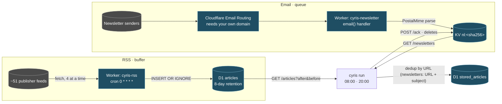

# Architecture

> Three questions this document answers: **who calls whom**, **how articles get in**, and
> **where each piece of data lives**. The last one is what breaks during a migration, and it had no
> written home here until 2026-08-27.
>
> Source of truth: `bootstrap.py` (who injects what), `service_layer/ports.py` (boundary
> contracts), `adapters/store/schema.sql` (what D1 holds), `workers/*/src/index.js` (ingestion).
>
> This document describes the system as it is. Open work is tracked outside this repository, and
> why each hard-to-reverse choice was made is in [`docs/decisions/`](decisions/).
> [§7](#7-architecture-changes) records each change to the architecture, with its commit on main.

## 1. Layers

```
entrypoints  →  service_layer  →  domain
     ↓               ↑
diagnostics       adapters   (implement the service layer's Protocols)
```

`bootstrap.build_deps()` is the only place the three meet. The core (`service_layer` + `domain`)
imports nothing from `adapters` — it names Protocols, and the composition root supplies bodies.

`diagnostics/` is off the pipeline entirely: `doctor` asks whether this deployment works, `compare` runs one window through two wirings and reports where they differ, and `blind_labels` draws a blind-label sample and scores the filter against it. It may import everything below it and nothing below it may import it, so deleting the
package would cost its commands and not one digest.

Pipeline: **Fetch → Store → Score → Process → Output**, orchestrated end to end by
`service_layer/run_digest.py`. The CLI parses arguments and calls it; it holds no logic of its own.

## 2. Wiring

```mermaid
flowchart TB
    subgraph EP["Entrypoints"]
        CLI["cli.py"]
        TRI["triage_server.py"]
    end

    subgraph ROOT["Composition Root · bootstrap.py"]
        DEPS["build_deps → Deps container"]
    end

    subgraph CORE["Core · service_layer + domain"]
        RUN["run_digest orchestrator"]
        UC["use cases: fetching · scoring · digest_pipeline<br/>filtering · summarize · cluster_news · vote_similarity · vote_order · tracking"]
        DOM["domain (pure): selection · models · similarity"]
        RUN --> UC
        RUN --> DOM
    end

    subgraph PORTS["Ports · Protocols (real IO boundaries)"]
        P1["LLMClient"]
        P2["ArticleRepository"]
        P3["FetchSource"]
        P4["Embedder"]
        P5["TopicRepository"]
    end

    subgraph ADP["Adapters"]
        LLM["Anthropic · Gemini · OpenAI · WorkersAI · AIGateway"]
        STORE["D1ArticleStore"]
        CFRSS["CloudflareRssSource"]
        CFNL["CloudflareNewsletterSource"]
        RSS["RssSource · direct poll, fallback"]
        HTML["HtmlDigestWriter"]
        PUB["publish_html_digest"]
        SYNC["sync_promotions"]
        USAGE["append_usage_d1"]
        NOTI["send_discord"]
        MAIL["send_digest_mail"]
        EMB["Embedder"]
        CLEF["ClefClient"]
        TAGS["D1TagStore"]
        STORIES["D1StoryStore"]
        DIGESTS["D1DigestStore"]
        TOPICS["D1TopicStore · JsonTopicStore"]
    end

    subgraph EXT["External"]
        API(("LLM APIs"))
        FEEDS[("Publisher feeds")]
        CFW{{"Cloudflare · Workers · D1 · KV · Pages"}}
        DISC{{"Discord"}}
        FS["Local filesystem<br/>json backend, or --output PATH"]
    end

    CLI --> DEPS
    TRI --> DEPS
    DEPS -. inject .-> CORE

    UC -->|Protocol| P3
    UC -->|Protocol| P1
    RUN -->|Protocol| P2
    RUN -->|Protocol| P4
    RUN -->|Protocol| P5

    P1 -. impl .-> LLM
    P2 -. impl .-> STORE
    P3 -. impl .-> CFRSS
    P3 -. impl .-> CFNL
    P3 -. impl .-> RSS
    P4 -. impl .-> EMB
    P5 -. impl .-> TOPICS

    RUN -->|direct inject| HTML
    RUN -->|direct inject| PUB
    RUN -->|direct inject| SYNC
    RUN -->|direct inject| USAGE
    RUN -->|direct inject| NOTI
    RUN -->|direct inject| MAIL
    RUN -->|direct inject| TAGS
    RUN -->|direct inject| STORIES
    RUN -->|direct inject| DIGESTS
    RUN -->|direct inject| CLEF

    LLM --> API
    STORE --> CFW
    CFRSS --> CFW
    CFNL --> CFW
    RSS --> FEEDS
    PUB --> CFW
    SYNC --> CFW
    USAGE --> CFW
    TAGS --> CFW
    STORIES --> CFW
    DIGESTS --> CFW
    TOPICS --> CFW
    NOTI --> DISC
    MAIL --> CFW
    EMB --> CFW
    CLEF --> CFW
    HTML -->|json backend only| FS
    TOPICS -->|json backend only| FS
    CLI -->|--output PATH, operator's file| FS

    classDef port fill:#0F6E7A,stroke:#5AC3CC,color:#fff;
    classDef fallback fill:#A8590C,stroke:#DFA45E,color:#fff;
    classDef bad fill:#98292B,stroke:#E28079,color:#fff;
    classDef cloud fill:#1F4E63,stroke:#7FB6CC,color:#fff;
    class P1,P2,P3,P4 port;
    class HTML,FS fallback;
    class RSS,FEEDS bad;
    class CFNL,CFRSS,PUB,SYNC,CFW,STORE,USAGE,TAGS,STORIES,DIGESTS,EMB,MAIL,CLEF cloud;
```



**Legend**: 🟢 Protocol boundary　🟠 the `json` backend's fallback path　🔴 must not exist in the
target architecture　🔵 already on Cloudflare

### No Obsidian writer — deleted 2026-08-27 (M1)

`DigestWriter` — the Obsidian markdown note — is **gone**. The digest's output is the HTML digest on
Cloudflare Pages, plus the article store in D1. A reader who wants the digest in Obsidian exports it
themselves from either.

It took its whole dependency cone with it: `adapters/output/digest.py`, `adapters/output/
article_export.py`, `cyris.toml [obsidian]`, the `CYRIS_VAULT_PATH` environment variable, the vault
bind mount in `docker-compose.yml`, `cyris articles export`, and the vault export that ran on a
triage accept. `--dry-run` renders the HTML instead, silently: it sends no notification, writes no
`usage_log` row and changes no table but its own `digest_runs` row.

### Local filesystem is a defect, not a tier

A cloud system has no local disk. Three edges once touched one; all three are closed, and none
closed by moving to the storage product first named for it:

| Edge | What it wrote | How it closed |
|---|---|---|
| `HtmlDigestWriter → FS` | digest + raw pages, then `wrangler pages deploy` | **not R2.** Pages Direct Upload over REST (`adapters/output/pages_deploy.py`); with D1 the pages are rendered in memory and never reach a disk — why not R2: [ADR-0004](decisions/0004-publish-over-pages-rest-without-r2.md) |
| `Embedder → FS` | `embeddings.json` (415 MB), rewritten whole every run | **not Vectorize.** The cache was deleted rather than relocated — a run re-embeds ~600 texts for ~20 neurons — why not Vectorize: [ADR-0005](decisions/0005-no-vector-index-and-no-embedding-cache.md) |
| `NewsletterArchiveSource ← FS` | local maildir | **deleted** 2026-08-27 (M1), superseded by the newsletter Worker |

One filesystem edge remains, the `json` backend, and it is the documented fallback rather than a
defect: while `[store] backend` is still `json`, `HtmlDigestWriter` writes `agent-vault/html/`, and
the article store, `topics.json` and `usage.jsonl` live in the agent vault (§4 lists each). With D1
wired, the site's file list comes from the `pages_manifest` table and nothing is written locally.

The other local write is deliberate and holds no state: `cyris run --dry-run --output PATH` and
`cyris regenerate --output PATH` write the rendered page to the path the operator names, and nothing
else. The file is a preview for a person to open, so it is not a store and needs no §4 row.

**The Container move was done when the `Local filesystem` node left the D1 path.** That was the acceptance
test.

### Two wiring strengths

| Wiring | Targets | Swap difficulty |
|---|---|---|
| **Via Protocol** (`ports.py`) | `LLMClient`, `ArticleRepository`, `TopicRepository` (`D1TopicStore`, `JsonTopicStore`), `FetchSource`, `Embedder` | **Low** — swapping the implementation never touches the core |
| **Direct injection** (no Protocol) | `HtmlDigestWriter`, `publish`, `sync_promotions`, `append_usage`, `notify`, `send_email`, `send_email_alert`, `D1TagStore`, `D1StoryStore`, `D1DigestStore`, `D1DigestInputStore`, `D1AreaStore`, `D1SourceTitles`, `ask_clef` (`ClefClient`), `page_serves`, `FeedChecker` (the wizard's feed check, `bootstrap.build_feed_checker`) | **Medium** — the core calls them directly; a second backend needs a Protocol first |

`ports.py`'s rule: *only genuine IO boundaries get a Protocol; single-implementation components are
injected directly.*

**Spend is part of both provider ports, in each one's own shape.** `llm-compare` and `embed-compare`
exist to answer "which provider costs less", so the number they read cannot be an undeclared
attribute a second implementation is free to omit. The two shapes stay separate because the
lifetimes differ: `LLMResponse.neurons` is what one call cost and `UsageStats.add` sums it, while
`Embedder.usage` (`ports.EmbeddingUsage`) accumulates across the batches one `embed` run makes.
`None` is the answer for a provider that reports nothing — Gemini's `batchEmbedContents` returns
bare vectors, and `0.0` there would read as a measured cost of nothing.

### `diagnostics/` — the tools that inspect the deployment

`src/cyris/diagnostics/` holds the tools whose subject is the deployment rather than the digest:
`doctor`, which builds the real adapters itself and never calls `build_deps`; `embed-compare` and
`llm-compare` in `compare.py`, which build two wirings and return rows; `config show` in
`config_show.py`; and `labels draw` and `labels report` in `blind_labels.py`, which draw the
blind-label sample (§4) and score the filter and the embedding preference against its answers. The CLI parses, prints and owns every local write. `tests/test_core_imports.py`
fails if `service_layer/` or `domain/` imports `cyris.adapters` or `cyris.bootstrap` at runtime,
and fails again if anything below `diagnostics/` imports it back. Why a layer of its own:
[ADR-0007](decisions/0007-diagnostics-is-its-own-layer.md).

One constraint shapes the store: **`ArticleRepository` is synchronous**, so `D1ArticleStore` uses a
blocking HTTP client ([ADR-0002](decisions/0002-article-repository-stays-synchronous.md)).

## 3. How a digest is made

### 3.1 Two ingestion paths



**RSS — a buffer, read idempotently.** `workers/rss` polls every feed on the hour, four at a time
(ten at once drew HTTP 429s from Substack). Entries their feed dates more than 8 days back are
dropped *before* the write — blogs ship months of history in their feed, and because the read goes
by buffer entry, that history would otherwise reach the next digest as new. Writes are
`INSERT OR IGNORE`, so re-seeing an entry every hour is free. `cyris` reads a time window with
`GET /articles?after=&before=`, which selects by when an entry *entered the buffer*, not by the date
its feed gave it, so an entry a feed lists late still reaches the next run. That holds while each
run's window reaches back past the previous run by more than one poll's duration: a poll stamps its
rows when it starts, so a row can land after a run has already read past its stamp. `RssSource`
stays on publish time. **There is no ack**, so a crashed digest simply reads the window again.
Each poll also upserts every polled feed's outcome into `feed_health` (§4), after the articles and
never at their expense: a feed that keeps failing used to be a `console.warn` per hour, gone with
Workers Logs after 7 days, and on 2026-09-28 one had stored no article ever behind an hourly HTTP 503.

One reader outside the run reads this edge: the onboarding wizard's vote cards (§6). It asks the
Worker for a `POST /poll` out of the cron, so the feeds a reader picked a moment ago are in the buffer,
then reads the buffer's whole 8 days through the same `CloudflareRssSource` a run reads it with, or
through `RssSource` on a deployment without the Worker. `bootstrap.build_rss_source` picks that edge
for both `build_deps` and `build_onboarding_articles`, so a card's URL is the URL the first run reads:
a vote lands on its row by URL, and a second parser would spell some URLs differently. The poll
writes only the buffer, as the cron's would.

Why a buffer rather than a poll at digest time, and why it has no ack:
[ADR-0001](decisions/0001-rss-arrives-through-an-hourly-buffer.md). `RssSource` (direct polling)
remains as the no-Worker fallback and is correct only for slow feeds.

**Email — a queue, drained with an ack.** Cloudflare Email Routing delivers to the `email()` handler
in `workers/newsletter`, which parses the message with PostalMime and stores
`{from, subject, html, text, date}` in KV under `nl:<sha256(from|subject|date)>` — so a re-delivered
copy overwrites instead of duplicating. `cyris` pulls with `GET /newsletters`, matches each sender
to a source via that source's `email_match`, and then `POST /ack` **deletes** what it processed.
Unmatched senders and private replies are ACKed without ingesting, so they cannot pile up.

**A preview must not drain a queue.** Because this edge and the vote sync consume rather than
read, `--dry-run` is decided in `bootstrap.build_deps`, not inside `run_digest`: the preview gets
a newsletter source constructed with `ack=False` and no `sync_promotions` at all. Until
2026-09-06 it got neither, so a preview against production deleted the issues it had just
declined to store, and stamped vote verdicts on their way to draining the vote queue. Skipping
the writes downstream does not undo an upstream delete — a source that takes has to be wired
differently, which is why the decision lives at the composition root. The silent dry run of
`run_digest` keeps the same rule for the stores: `cyris regenerate --output` previews a stored
period through the file only, and a rerun that publishes is the only form that writes a digest.
A rerun is the one case `run_digest` enforces itself: it never pulls the vote queue, whatever it
was built with, because it replays a period that already ran and must not consume clicks meant for
the next one.

| | RSS | Email |
|---|---|---|
| Shape | buffer | queue |
| Read | idempotent time window | pull + ack |
| Crash mid-run | reread, nothing lost | loses at most the current batch |
| Retention | 8 days from buffer entry, pruned by the Worker | until ACKed |
| Needs your own domain | no | **yes** — Email Routing cannot run on `*.workers.dev` |

Each newsletter issue also needs a canonical article link. That extraction is structural, not a
hostname allowlist, and has its own rule set — see
[the newsletter link section in CLAUDE.md](../CLAUDE.md) before touching
`adapters/fetch/newsletter.py`.

### 3.2 From articles to a digest

`fetch_all_articles` merges every `FetchSource`, **deduplicating by URL — last source wins**,
except that two newsletter issues with different ids sharing one URL are both kept. A source that
throws is logged and skipped; the run continues degraded rather than failing.

Everything then goes to the store, and the store's `url` PRIMARY KEY is the second dedup: an article
seen in a previous window is not processed again. A newsletter issue is deduplicated by URL plus
subject, realised without changing the key (`adapters/store/newsletter_dedup.py`): when its URL is
already held by an issue of the same source with a different subject — a sender's repeated nav link
— it is stored under its synthetic `newsletter:{id}` URL and loses that link. Same URL and same
subject is a re-delivery and is skipped. The extractor's `Article.url` may repeat across issues; the
stored URL cannot.

The run cap, `[digest] max_articles_per_digest`, is applied once, at the pending load in
`run_digest`: a run scores and digests the window's newest N pending articles by publish time,
across all sources. A capped run therefore cuts the oldest-published rows first; the tripwire is
`received + suppressed + suppression_honoured == max_articles_per_digest` in
`digest_runs.summary`, a missing key counting as 0: `suppressed` counts what this run flagged,
`suppression_honoured` what an earlier run's hold alone removed. No source applies it, because one that cut first would drop articles before the
store saw them. The RSS Worker read has a bound of its own, the Worker's row ceiling, because every
row carries the feed's full content and the Worker holds the whole result in memory. A read that
fills the ceiling logs a warning, since the window's earliest-buffered rows then stay unstored.

An issue is keyed by `(date, period)`, and a run stores its issue over any other with its key
(`adapters/store/digests.py`). The hourly tick (`cyris run --if-due`) takes the period from the
schedule and the date from its own clock in `general.timezone`. A manual run (`POST /run?period=`,
`cyris run --period`) names the period, and may name the date too (`&date=`, `--date`), which only
`--if-due` refuses; the app Worker takes a named date only when it is today or yesterday in the
deployment's time zone, and refuses it with 503 when it cannot read that zone. Two callers name a
date: the onboarding's first issue (§6), and a tick that catches up a digest hour whose run never
finished (§5), which names that hour's period and the hour's own local date, so an evening caught
up after midnight keeps its issue's date. Without one, the pipeline dates
the issue when it writes it.

Each source carries a **lane**, which decides how much attention it gets:

| Lane | Treatment |
|---|---|
| `skim` | Batched headline extraction, aggressively discarded. News-tagged articles are additionally clustered by topic. |
| `read` | Scored by the LLM, then split by `[routing] summarize_score_threshold` into full summaries and brief mentions. Every one is a pebble on the page (below). |
| `follow` | Passthrough. Never scored or filtered — followed groups and newsletters go straight through, each a pebble on the page. An item carries an excerpt of its own text, or, with `digest.summarize_follow` on (§5), the read lane's explanation, written in one call per source. |

Between scoring and the pipeline one optional filter runs. **Vote similarity** suppresses candidates
sitting close to a downvoted article — it runs over *every* candidate, not just scored ones, because
the scorer skips news and the first downvote was news-tagged. A candidate is flagged when its
cosine to its nearest downvote is an outlier among this run's candidates: a robust z-score above
`OUTLIER_MARGIN` (3.5), and not closer to an upvote. A window of fewer than
`MIN_OUTLIER_WINDOW` (10) candidates flags nothing, because its median and MAD rest on two or three
articles. Because the cut is relative to the window,
more votes do not suppress more articles by themselves (ADR-0017). The seeds are the newest
`max_seeds` human-stamped articles per side, one per topic (§4 *Topic members*): a vote on a topic
stamps every member, and its newest-stamped member stands for it, so a 15-article topic takes one
seed, not 15. When the topic store cannot be read, each voted URL is its own seed, as before
topics, and `run_summary`'s `vote_similarity_topic_dedup_skipped` says why. Every voted URL, not only
the seeds, is kept out of the candidates. Here it suppresses; its only other use is the nearest votes it hands Clef when
`preference_source = "clef"`. The issue's order comes from topic votes, not from its verdicts
(below). Prompt-level preference learning was removed on 2026-08-27 because it had never
produced a profile. Each flagged candidate leaves a row in `suppressions` (§4) that holds it for
`SUPPRESSION_CLOCK_DAYS` (7) days from the run's start; before it drops candidates, every run reads
the holds not yet expired and keeps those candidates out of the digest, whatever its own window
judges. A hold never stamps `triaged_at` or rejects: the article stays pending. A human action on
the article since (a vote, `cyris articles accept|reject`) stamps `triaged_at` and ends the hold's
effect: a candidate with `triaged_at` set is neither dropped nor counted by its hold. That rule
lives once, as the live-hold query in `adapters/store/suppressions.py`. On D1, every
candidate it judged also leaves a row in `vote_similarity_shadow` naming its nearest upvoted and
downvoted article and both cosines (§4), a record that changes nothing the run selects.

**Areas** are the reader's closed set of topics (D1 `areas`, §4, §5). Scoring is offered the active
names and returns each article's pick; a name the model suggests because no active area fits is
counted on a proposed `areas` row for the reader to confirm, and never changes the scores. After the digest is built, each item gets the name of its first article's pick or else its
source's area (`service_layer/area_stamp.py`), before the digest row is saved.

**The area skeleton** is a read-only view over the stored issue, `layout_by_area` in `domain/area_layout.py`, and no output draws it any more: the web page, the HTML and plain-text mail and the Discord embeds all draw the three layers of `layer_by_lane` (below), and the code waits for its deletion. It places each card, group, cluster and row, and a stored issue's news paragraphs, under its area, sections in the issue's `area_order` (frozen at the stamp). The Top story stands above the sections and tracked topics sit outside them. An issue with no area order gets one unnamed section; entries no active area claims close the issue under one fixed label. No area is cut to a quota: every entry the issue holds is placed.

**News paragraphs** are no longer written (ADR-0023): the page draws each news cluster and kept headline itself, so a run makes no paragraph call. An issue stored while the paragraph step ran (ADR-0022) keeps its `DigestContent.news_paragraphs`; the page draws each cited unit as sand at two URLs or more and as water otherwise, with the paragraph's text on its first unit, and the mail and Discord draw them the same way.

**Topic tracking** runs right after it, over the candidates vote similarity left
(`service_layer/tracking.py`). Each tracked topic (§4, §5) is a name, one sentence the reader wrote,
a cosine threshold and the embedding model that threshold was set for. The run embeds each sentence
once, compares it with every candidate title, and lists the titles at or above the topic's threshold
in the issue's Tracking section. It calls no LLM. A title vote similarity already embedded this run
is reused, and the rest are embedded once, so `run_summary`'s `embedding` is the run's whole
embedding spend either way. A topic set for a model other than the run's is skipped, never judged,
and `run_summary`'s `tracking` names it beside each judged topic's hit count. The hits are the
issue's `DigestContent.tracked_topics` and nothing else: no store of their own, outside the issue's
article count, and no article's state changes for being one. A hit the issue does not show in a
layer stays pending, so the next run in the window can list it again.

The summarize call writes a summary for each group and one for each article. `layer_by_score`
then lays them out inside `DigestPipeline`: the Top story is a group only when two or more of its
articles reach `[routing] score_threshold`, and then it carries every article of that group, since
the group summary covers them all. Every other article is one Features card under its own summary,
highest score first. That is the stored issue's shape, which the page, the mail and Discord all
draw through `layer_by_lane`. **There is no output cap** (ADR-0023): every article the run kept is in the issue and
on the page, and only the intake cap `max_articles_per_digest` (above) bounds an issue. The
issue's `articles_included` is the number of article URLs it shows, `len(digest_urls(content))`, set
once the order is final: a topic of three reports counts three, and a Tracking hit counts none. The
stats card, the archive, the mail, Discord's Kept line and `usage_log` all read it; an issue stored
before 2026-10-29 keeps the count it was saved with, a cluster counting one.

**The page draws three layers** (`layer_by_lane` in `domain/layers.py`, ADR-0023), decided by lane
and by member count in this issue alone, never by a score or an area: every `read` or `follow`
article is a pebble, its own card, the Top story's group split into its articles; a news cluster of
two or more articles is sand, one block whose members stay folded; a cluster of one article, or a
headline the filter kept, is water, a row. Tracking comes first, then pebbles, sand and water. Each
item carries exactly one vote group: a pebble's and a water row's vote is for its article, and a
sand block's is for every member URL, posted once per URL as a cluster's vote was; the vote
sync turns those posts into one vote on the item's topic (§4 *Topic votes*). A cluster is a stand-in for the topic it will
become: this issue's `cluster_news` groups, never across issues, and sand's line is its first
member's excerpt until sand-what-happened writes one.

**The vote order** (`[digest] rank_by_preference`), option I of ADR-0023. When it is on, each item
is scored as its topic (§4 *Topics*): the topic's own votes, each halving every
`digest.vote_half_life_days`, plus the preference of its entity tags. A tag's preference is the
decayed votes of the other topics carrying it, divided by df, the number of topics carrying it among
those last seen in the `digest.topic_lifetime_days` before the run's start and this issue's own; a
topic's own vote is not counted again through its tags, and domain and region tags carry nothing
(`domain/topic_rank.py`, `service_layer/topic_order.py`). A voted topic outside that window lends
through its tags only while its decayed vote is worth more than `RECENT_VOTE_CUTOFF`, so the topics a
run looks up do not grow with the whole vote history. Embeddings take no part, so the order needs
no vote similarity. Every article URL takes its topic's score, and `order_by_preference`
(`domain/selection.py`) orders the Features, after their score sort, the news clusters and the kept
headlines, each list by its entries' best article's score. Equal scores keep the incoming order, so
an issue with no vote keeps it whole, and the Top story never moves. While topic ids last one issue
and today's tags are stored as `domain` (§4), a vote moves no published issue: its topic is in no
later issue and shares no entity tag with one, and the issue it was cast on cannot be reordered by
it either. A rerun skips the vote sync, so the vote is synced by the next normal run, which publishes
a newer issue and so makes a publishing rerun of the voted one refused; a rerun also re-clusters,
so its stand-in ids can differ. Votes take effect once the filter assigns topics whose ids last
across issues. On the page, water lists
the one-article clusters first and the kept headlines after them, each part in that order: the two
come from separate model calls and are ranked apart. The order rejects nothing and stamps no
`triaged_at`, and with no cap it changes only where an item stands, never whether it is shown. Off,
with no topic store, or when the topic store cannot be read, the issue keeps the score's and the
model's order; a failed read costs the order, never the run. `run_summary` records which: `preference_rank_applied`, the reason in `preference_rank_skipped`, and
`preference_rank_moved_features` and `_units`, the Features positions and the cluster and headline
positions that differ from the order without it.

The recent-topic list (`recent_topic_list` in `service_layer/topic_order.py`) is the topics last seen
in `digest.topic_lifetime_days`, plus each topic the reader voted up whose net decayed vote is still
above `RECENT_VOTE_CUTOFF` (0.1, about four half-lives; owner, 2026-10-30). Nothing reads it yet: it
is what vault card `filter-assigns-topics` hands the model.

**Who scores them** (`digest.preference_source`, `cosine` or `clef`). `cosine` is the order above;
the value keeps its name because it is a stored setting, though no cosine takes part since ADR-0023.
`clef` replaces the topic score with Clef's probability that the reader upvotes the item,
asked once per kept item, the Features the issue kept and every news article the filter kept or
the clustering grouped, and no other candidate, so a run makes tens of calls, not one per candidate. Each question carries the article's title, source and
first `digest.scoring_snippet_length` characters (the snippet scoring reads), and the titles, never the text, of its five nearest upvotes and five nearest
downvotes, which vote similarity supplies. The filter is untouched, and no `triaged_at` is
stamped. The whole issue falls back to the topic order when Clef cannot score every asked item:
vote similarity off or skipped, no `CLOUDFLARE_AI_TOKEN` (or `CLOUDFLARE_EMBEDDING_API_TOKEN`) with `CLOUDFLARE_ACCOUNT_ID`, no kept
item with a nearest vote, a failed call, a question left unanswered, or the pass passing 60 seconds. A half-Clef order would mix
two scales, so one failed question drops all of them; the run does not fail. `run_summary` records
`preference_source` (`topics` or `clef`) and `preference_model` for the order used, `preference_clef_skipped` with the
reason when `clef` was chosen and did not order the issue, and `clef` with the calls, answers
and input tokens it spent. That spend stays out of the LLM `usage`.

Two analytics facts are persisted beside the digest, both fail-soft — a write failure is logged
and the run continues. Topic tags emitted by scoring and by news clustering land normalized in D1
`tags`/`article_tags` (`D1TagStore`), and each run's story membership — which
articles the clustering step grouped — replaces its
(date, period) window in `stories`/`story_members` (`D1StoryStore`). Both stores are direct
injections built only when D1 is configured; with `backend = "json"` they are absent and the run
skips the writes. A third fact is not D1-only: each non-dry run writes the issue's topics,
their members and tags through `TopicRepository` (§4), to D1 or to the `json` backend's
`topics.json`, also fail-soft (`topics_error` in `run_summary`).

A publishing run also saves the URLs it fed the pipeline to `digest_inputs`, which is the record a
rerun rebuilds from. `cyris regenerate` has two forms over a stored issue: a re-render to a file, with
no LLM call and no write, and a rerun over the recorded URLs, which publishes only when that issue is
the newest by date and period (an older one returns `not_latest` before any LLM call). A rerun takes
each article as its state is now, so the input set is fixed but the verdicts are not, and an issue
recorded before `digest_inputs` has no record to rerun from. A rerun's publish counts as done only
when the live page serves the bytes just rendered, compared byte for byte; a scheduled run keeps
`_page_is_live`. A publishing rerun skips the republish check below and sends no Discord message
or mail.

`cyris run --dry-run --output PATH` is the silent preview of a period: it renders the page to PATH,
prints `Wrote PATH`, and sends nothing, writes no `usage_log` row and changes no table but
`digest_runs`.

Output is the HTML digest and a companion raw page listing what this run judged plus whatever is
still pending — uncapped, so what the digest left out stays visible; rows an earlier run in the
overlapping 24h window already judged are left off, since they were on that run's raw page — both
deployed to Cloudflare
Pages, followed by a notification to Discord and, when a recipient is set, by mail. A lost
notification does not fail the run, which stays `ok`; `run_summary` records each channel's outcome
instead, `discord_notification` as `sent`, `skipped` (no webhook) or `failed`, and
`mail_notification` as `delivered`, `queued`, `skipped` (no recipient) or `failed`, each a
`{"status": ...}` object that carries a `reason` when it failed: Discord's HTTP status and own
message, the Email Sending API's message, or the missing credentials. A dry run and a rerun send
neither and record neither. An issue
whose publish failed is not digested again: its articles are already accepted. Instead every
non-dry run starts by comparing D1 `digests` with `pages_manifest` and publishes each stored
issue the site lacks, re-rendered from its row, before anything can end the run early; the raw
page is rebuilt from the issue's `digest_inputs` row, each article as its state is now, so a
republished issue links one only when that row exists. A run that
raises inside `run_digest`, or fetches nothing while a source failed, sends a failure alert to
the same channels after the run is recorded. It carries the error or the failed sources and the
time the run started. A scheduled run (`--if-due`) that stops before `run_digest`, on incomplete
settings or a `build_deps` that raises, sends `Digest run could not start` to the same channels,
on a digest hour only, since every hourly tick hits the same failure; it leaves no `digest_runs`
row. Settings that cannot name the schedule or a channel send nothing, and so do a D1 the
container cannot read and a container that never starts: those are left to Workers Logs. A dry
run, a run started by hand and a SIGTERM-cancelled run send no alert. A catch-up run (§5) is a
`--period` run: it never sends `Digest run could not start`, and a failure inside `run_digest`
alerts as any other does, so a failure that persists alerts once per retry. Votes cast on the
published digest go to the promote Worker's KV and are drained at each digest run, by the run
itself and by the `cyris promote-sync` after it, which is what turns a click into a
`triaged_at` stamp. The stamp is the sync's time, not the click's; the click's time, the payload's `ts`,
is kept only on the topic vote the sync writes beside it (§4 *Topic votes*). A
vote on a grouped item posts once for every URL in the group, so rows stamped at one instant may
be one judgment rather than independent labels. The raw page's triage view is the only triage surface; the pending backlog
across days is reachable only through `cyris articles`. `/labels` writes human verdicts too, through
the same `record_votes` the vote sync calls and stamped at the answer's own time, but only on a drawn
sample (§4 *Blind-label sample*): it measures the filter, and triages nothing a run would show.

A run whose provider is not `none` but whose scoring, filter or summarize step went on without
the LLM's answer, because no client was built or its call failed, is *degraded*
(`is_degraded_run` in `domain/models.py`): the notification, the page and the mail open with a
notice saying so.

## 4. Data residency

Every persistent datum, where it lives now, and where it is going.

**What this table covers:** state the pipeline keeps — anything a later run or a
reader depends on. It does not cover a diagnostic command's output, and it does not need to: the
comparisons write nothing at all, they emit, and where that lands is the shell's decision.
`tests/test_local_writes.py` holds the set of files allowed to touch local disk at six: the four that write the `json`
backend's files, which the D1 path does not use, the vault probe `cyris doctor` skips under D1,
and the file `--output` names. A new one fails that test before it can become a row
nobody added. `tests/test_residency_covers_schema.py` does the same for the other half: every
table `schema.sql` creates must appear in the rows below, so a new table cannot ship unlisted.

| Datum | Today | Destination | Notes |
|---|---|---|---|
| Article store | **D1 `stored_articles`** | same | `url` PRIMARY KEY is the dedup key; a colliding newsletter issue is re-keyed to `newsletter:{id}`. Besides a run's save, the onboarding votes step (§6) stores each card the reader marked and then accepts or rejects it with `triaged_at`, as a `/labels` answer is written; a card left alone gets no row and stays in the buffer for the first run |
| Tag vocabulary | **D1 `tags`** | same | Normalized tags emitted by clustering and scoring |
| Article tags | **D1 `article_tags`** | same | URL-keyed article membership in the tag vocabulary |
| Stories | **D1 `stories`** | same | Pre-truncation news clusters, keyed `{date}-{period}-{urlhash}` (content-derived from member URLs), replaced per window |
| Story membership | **D1 `story_members`** | same | URL-keyed article membership in each story |
| Topics | **D1 `topics`**; `topics.json` in the agent vault for a `json` deployment | same | One row per topic: id, name, the first and last time an issue held it (ADR-0023). Written by every non-dry run after the pipeline (`TopicRepository.save_topics`), fail-soft. A stand-in until the filter assigns topics: each item of the page is a topic of this issue only (`domain/topics.py`), so an id never spans two issues. A topic left with no member and no vote is deleted |
| Topic members | **D1 `topic_members`**; `topics.json` for `json` | same | Which articles an issue put under a topic, keyed by topic, URL and issue `(digest_date, period)`. A rerun of an issue replaces that issue's rows. Read to turn a voted URL into its topic. Not `stories`/`story_members`, which stay the clustering step's record |
| Topic tags | **D1 `topic_tags`**; `topics.json` for `json` | same | A topic's normalized tags with their kind, `entity`, `domain` or `region`: the tags its newest save gave it, so a rerun that tags a topic differently replaces them. Today's tags carry no kind, so the stand-in stores every one as `domain` (`STAND_IN_TAG_KIND`) |
| Topic votes | **D1 `topic_votes`**; `topics.json` for `json` | same | Append-only, keyed by topic and click time: the direction (1 or -1). Written by the vote sync (`sync_promotions`): a voted URL that an issue put under a topic becomes one vote on that topic, a group's per-URL posts collapsing to one row timed by the promote Worker's `ts`. A same-direction vote on the same topic within `ONE_CLICK_WINDOW` (60 s) of a recorded one, with no opposite vote between them, is taken as that click again and not written, since a sync can ACK part of one click's posts before the rest arrive. A sync whose topic-vote write fails still stamps and ACKs its votes, since the stamp is the vote's record and a held ACK would re-stamp the same URLs every run; that sync's topic votes are lost, and `run_summary`'s `topic_votes_failed` says why. A URL no topic holds (an issue published before topics, the raw page) writes no row |
| Article image URL | **D1 `articles.image_url`** and **`stored_articles.image_url`** (the `json` store keeps it in the article), carried on each Stories item in the issue's `DigestContent` | same | The picture a feed entry names for its article, as a URL only: `media:thumbnail`, `media:content` or an image `enclosure`, else the first `` in the entry's content. Parsed by `workers/rss` when it buffers the entry and carried with the article to the store, so a rerun shows the image the article had. The image bytes are never fetched or kept: the digest page loads them from the feed's host in the reader's browser, with no referrer (UI spec §4 *story image*). No article page is fetched for an `og:image` (owner, 2026-10-31): a feed's own picture costs no new outbound request. A newsletter issue has no feed, so it has no image. The digest pipeline stamps it on Stories items only, leaving out a picture two or more of one source's articles in the issue share (`domain/story_images.py`); the mail shows none |
| RSS buffer | **D1 `articles`** | same | Same database, different lifecycle: disposable, 8-day retention counted from buffer entry |
| Feed health | **D1 `feed_health`** | same | One row per RSS feed the Worker has polled: the current failure streak, the last error and when, and the last success. Written by `workers/rss` on every poll, read by `cyris doctor` and `/settings` together with the newest `stored_articles.first_seen_at` per source, which needs no state of its own; `cyris run` neither reads nor writes it. Both `schema.sql` and the Worker create it. A row for a retired source stays behind, harmless, since both readers start from `sources`. D1 only: a `json` deployment polls no Worker |
| Source definitions | **D1 `sources`**; `sources.yaml` for a `json` deployment | same | One home per backend. Both cyris and `workers/rss` read the table; an empty one is a deployment waiting for onboarding, so it polls no feed and `cyris run` ends having fetched nothing, with no failure alert (`Config.awaiting_onboarding`) |
| Runtime settings | **D1 `settings`**; `cyris.toml` for a `json` deployment | same | Grade D. One home per backend, no value in code, and a missing key stops the run — see §5 |
| Tracked topics | **D1 `tracked_topics`**; `cyris.toml` `[[tracked_topics]]` for a `json` deployment | same | Grade D, one row per topic: name, description, threshold and the embedding model the threshold was set for. Written by `/settings` (Tracking), read by `load_effective_config` beside `sources`. Not rows of `settings`: an empty table is a deployment that tracks nothing. A topic's hits are not kept here, or anywhere of their own: they live in the issue's `DigestContent`, which D1 `digests` stores |
| Areas: name, position, status, merged target, proposal counts | **D1 `areas`** (none for a `json` deployment) | same | Grade D, one row per area, written by `/settings` (Areas). Read by `load_effective_config` beside `tracked_topics`, so every run sees the closed set the model picks from. A `proposed` row carries the counts a suggestion has accumulated; a `dismissed` or `merged` row stays so its name keeps resolving |
| Area birth threshold | **D1 `area_birth_threshold`** (none for a `json` deployment) | same | Grade D, at most one row, written by `/settings` (Areas). Read only by `/settings`, to mark which proposals meet it. No run reads it, so an unset threshold changes no run |
| Discord webhook | **D1 `settings`** | same | written by `/settings`; `""` means notifications are off. A `json` deployment keeps it in `cyris.toml [notify]` |
| Mail addresses (recipient, sender) | **D1 `settings`** | same | written by `/settings` after a test message reaches the recipient; an empty recipient means no mail. A `json` deployment keeps them in `cyris.toml [notify]` |
| LLM spend | **D1 `usage_log`** | same | `agent-vault/usage.jsonl` is the no-D1 fallback only, the same alternative the article store has: `build_deps` picks one or the other, never both |
| Promote votes | **KV** (`workers/promote`) | same | Transient queue, drained at each digest run |
| Inbound newsletters | **KV** (`workers/newsletter`) | same | Transient queue, drained and ACKed per run |
| Deployed site's file list | **D1 `pages_manifest`** | same | path → Pages asset hash, a few KB. The *bytes* are Cloudflare's, not ours. A failed cleanup after a save can leave an older stamped generation in the table; readers ignore it, since the newest `updated_at` wins |
| Interest map page (`/interest`) | **derived**, drawn by the container on each request | same | No store of its own, and no copy in the Pages project: the `ui` container renders it from the live holds in D1 `suppressions` (the run's own definition), `article_tags` and the voted `stored_articles` whenever a signed-in reader opens it, so it is never older than the request. A copy an earlier release published as `/interest.html` leaves the site at the next deploy (`RETIRED_PATHS` in `adapters/output/publish.py`). D1 only: a `json` deployment answers 409 |
| Digest runs | **D1 `digest_runs`** | same | One row per `run_digest` call on every path — `no_articles`, `no_pending`, `error` included — with status, period, dry-run flag, fetch counts, the image's `CYRIS_GIT_SHA`, the degraded judgement and the whole `run_summary` as JSON; a run that raised also carries `error`, the text its failure alert sends. Written after the log line, inside its own guard. Besides `cyris doctor`, the onboarding first-issue step reads the newest row back (`GET /api/onboarding/first-issue`, §6) to tell the reader how the run it started ended. D1 only: a `json` run writes nothing and keeps only stdout |
| Digest content | **D1 `digests`** | same | One row per issue, keyed `(date, period)`, last run wins: the final `DigestContent` as JSON (its `area_order` included: stored for the area sections, which no output draws since the mail and Discord took the three layers, and read by nothing until the area skeleton is deleted) plus `raw_page`, the flag saying whether that run's digest page linked a raw companion page — the two inputs the digest page renders from. The raw companion page is rebuilt from `digest_inputs`, not from this row, with each article's state as it is now. Deleted only by `scripts/prune_archive.py`, for named issues (see docs/operations.md). D1 only: a `json` run keeps no copy |
| Digest inputs | **D1 `digest_inputs`** | same | One row per issue, keyed `(date, period)`, last write wins: the URLs a publishing run fed the pipeline, in order, as a JSON array. Written by a non-dry run only, before publishing; a dry run and a rerun write nothing. A URL record, not article state: a rerun reads each article by URL as it is now, and votes, vote-similarity seeds, settings, tracked topics, areas and the embedding model are read live too, so a rerun shows their current values. A row whose article `cyris articles clean` deleted drops out of the rerun. An issue recorded before this table has no row, so it cannot be rerun. Deleted only by `scripts/prune_archive.py`, for named issues (see docs/operations.md). D1 only: a `json` run keeps no copy |
| Vote-similarity pool | **D1 `vote_similarity_shadow`** | same | One row per candidate a run judged against the reader's votes, keyed `(run_at, candidate_url)`: the nearest upvoted and downvoted article with each cosine, and the embedding model. `run_at` is the run's `started_at`, which `digest_runs.summary` also carries, and its `vote_similarity_judged` is the run's row count. Raw data with no verdict: the suppression decision is not stored here; `suppressions` holds it. Written by `run_digest` right after `judge_by_votes`, inside its own guard, from the cosines that call already computed, so it costs no embedding call; a run whose similarity pass skipped, and a dry run, write nothing. Nothing reads it yet. D1 only: a `json` run keeps no copy |
| Suppressions | **D1 `suppressions`** | same | One row per candidate a run newly suppressed as an outlier, keyed `(candidate_url, run_at)`: the downvote it sat nearest to with its cosine, the upvote cosine (NULL when there was no upvote seed), the outlier score, the `reason`, the embedding `model` that judged it, and `until`, the instant the hold expires (run start plus 7 days). `model` is a record, not a filter: a hold outlives a change of `vote_similarity` provider or model for up to `SUPPRESSION_CLOCK_DAYS`, because it holds a verdict rather than a cosine to compare (ADR-0017). A suppression is not a vote: the article stays `pending` with `triaged_at` NULL, and nothing else reads this table's row as a decision. A later human action stamps `triaged_at`, and a run then ignores the hold for that article. A held article still pending is judged with the window and counts toward its median, but this run's verdict does not lift the hold (ADR-0017). Written by `run_digest` after judging, inside its own guard, and never on a dry run. D1 only: a `json` run keeps no copy |
| Blind-label sample | **D1 `blind_labels`** | same | One row per filter candidate drawn for blind labeling by `cyris labels draw`, keyed by the draw's time and the URL: its position on `/labels`, the news split and the pipeline's state frozen at draw time, how many pool rows shared its stratum, the seed, the pool's cutoff, and the reader's answer (`up`, `down` or `skip`) with its time. Not columns of `stored_articles`: a label is written there exactly as a digest vote is, which overwrites the state that put the row in its stratum and leaves a label indistinguishable from a vote, so `cyris labels report` could neither weight the strata nor keep the labels out of the seeds that score them; a skip has no home there at all. One sample at a time: a draw replaces the previous one only with `--replace`, by inserting the new draw whole in one statement before deleting the old, and readers take the latest draw, so a replace that fails part way leaves one whole sample. D1 only: a `json` deployment has none |
| Applied schema steps | **D1 `schema_migrations`** (none for a `json` deployment) | same | One row per versioned step in `adapters/store/migrations.py`, recorded once it has run, or once its precondition shows it is not needed. Read on every boot to skip the steps already recorded; nothing else reads it |
| Pages deploy receipt | **D1 `pages_deploy_receipt`** | same | this D1 has published this Pages project; empty-manifest guard skips the Cloudflare probe. It is not a shortcut around the live-archive shortfall check |
| ~~Embedding cache~~ | — | **nowhere** | Deleted 2026-08-27. Not moved: a full run is ~600 texts ≈ 20 neurons of a 10,000/day allowance, so the 415 MB existed to skip five seconds of arithmetic |
| Run log (one `run_summary` JSON line per run, plus everything the container prints) | **Workers Logs**, 7 days | same | Not a record, and not state: it is the operational window — what last night's run fetched, spent and did. The `run_summary` dict itself is no longer only here: its durable copy is `digest_runs.summary` (one row per run, D1 only). Everything else the container prints stays in this window, and a longer retention is still not the answer |
| HTML digest + raw pages | **published from memory** | same | `agent-vault/html/` is the no-D1 fallback only. The deployed site is the archive of the pages as published; a digest page can also be re-rendered from D1 `digests`, and a raw page rebuilt from D1 `digest_inputs` with each article's state as it is now, so an issue recorded before `digest_inputs` has no raw page to rebuild |
| Marketing website (outside the pipeline) | **`website/` source + separate Pages project `cyris-site`**; the launch film in **R2 `musingfox-media`** under `cyris/` | same | Static M2 branding and landing page; no D1 manifest, user data, or connection to the digest publisher |

The article-store tables and the RSS buffer share one database (`cyris-rss`) on purpose
([ADR-0012](decisions/0012-the-app-deploys-from-the-repo-root.md)). A trial deployment (`scripts/trial-wizard.sh`, which renders its configs with
`scripts/provision_trial.py`; `docs/trial-deployment.md`) shares nothing: its rss Worker binds the
trial's own D1, the one its app uses, named like its app Worker, and its newsletter Worker binds the trial's own
`NEWSLETTERS` KV namespace. The wizard keeps a trial's inputs,
ids and progress in `.env.trial-<slug>-wizard` at the repo root, beside the trial's secrets files `.env.trial-<slug>`, `.env.trial-<slug>.access`, `.env.trial-<slug>-rss` and `.env.trial-<slug>-newsletter`;
those secrets files are the only copy, since Cloudflare cannot read a secret back. Only
`scripts/deploy_trial.py` changes that file after the wizard: it records the image it staged
there, so a later wizard run renders that image and not the first one, and the commit each of the
rss and vote Workers was last deployed from, so the next staging knows whether to redeploy them. A
trial's reader content can also come from production: `scripts/seed_trial.py save` copies
production's rows of the tables `scripts/reset_trial.py` clears into `~/cyris-trial-seeds/`,
outside the repo, and `restore` writes them into a trial's D1, never its `settings` or
`pages_*` rows, which name production's notification targets and Pages project.

### One store, one truth

`ArticleStore` (JSON) and `D1ArticleStore` both satisfy `ArticleRepository`, and `[store] backend`
picks one. **They are alternatives, never a pair**
([ADR-0003](decisions/0003-one-home-per-backend.md)). `cyris store diff` is what makes a split
visible; run it before and after any cutover.

## 5. Configuration: four grades

Every setting belongs to exactly one grade. Mixing them is what makes a deployment un-portable.
What each of these choices costs to host — measured usage against the plan's allotments, the free
plan's ceilings, and the priced alternatives — is `docs/hosting-and-cost.md`.

| Grade | Home | Changing it costs | Who sets it |
|---|---|---|---|
| **A · Baked defaults** | code | a release | nobody at runtime |
| **B · Deployment identity** | `cyris.toml`; the environment (`CYRIS_<TABLE>_<KEY>`) fills a key the file leaves absent or empty | an env change or a redeploy | the deploy flow |
| **C · Secrets** | environment / `.env` / Worker secrets | an env change | the operator, once |
| **D · Runtime-mutable** | **D1 `settings`** (a `json` deployment: `cyris.toml`) | a write, effective next run (the type size: within a minute) | the reader, in the UI |

### Every setting, graded

| Setting | Grade | Today | Target |
|---|---|---|---|
| Batch sizes | A | `BATCH_SIZE` in `service_layer/filtering.py` and `service_layer/scoring.py`, and on each embedder in `adapters/embedding.py` | unchanged |
| Propose titles per source | A | `TITLES_PER_SOURCE` = 5 in `adapters/store/source_titles.py` | unchanged — five headlines show a source's subject; each source's line is paid for in every Propose call. `tests/test_area_source_titles.py` holds the value to this row |
| Propose title length | A | `TITLE_MAX_CHARS` = 80 in `adapters/store/source_titles.py` | unchanged — a headline fits in 80 characters; a longer title is mostly a dek the model does not need. `tests/test_area_source_titles.py` holds the value to this row |
| Propose title lookback | A | `TITLE_LOOKBACK_DAYS` = 30 in `adapters/store/source_titles.py` | unchanged — the window `feed_health.py`'s `QUIET_DAYS` uses: a source silent that long is quiet, not described. `tests/test_area_source_titles.py` holds the value to this row |
| RSS Worker read ceiling | A | `WORKER_ROW_CEILING` in `adapters/fetch/rss_worker_source.py`, mirroring the clamp on `GET /articles` in `workers/rss/src/index.js` | done 2026-10-02 — a memory bound, not the run cap: every row carries full feed content. It is sent by value because the Worker's default without one is lower; `tests/test_rss_worker_source.py` holds the two equal |
| Interest map limits: 60 nodes, layout iterations and margin, drawing box | A | `MAX_INTEREST_NODES` in `domain/interest_graph.py`; `ITERATIONS` and `MARGIN` in `domain/graph_layout.py`; `INTEREST_MAP_WIDTH` and `INTEREST_MAP_HEIGHT` in `adapters/output/html_digest.py` | done 2026-10-17 — display limits, each with its reason beside it in code; a reader sets none of them |
| Feed health thresholds: unhealthy at 3 consecutive failed polls, or no stored article for 30 days (never included) | A | `UNHEALTHY_FAILURE_STREAK`, `QUIET_DAYS` in `adapters/store/feed_health.py` | done 2026-10-08 — one Substack 429 is routine, three hourly polls failing in a row is not; feeds publish weekly or monthly, so a shorter silence is noise. `cyris doctor` and `/settings` both judge through `FeedHealth.problems`, so neither copies a number |
| Pages publish timing: the 180s budget and 120s run reserve, the 120s verify budget of a publishing rerun, the stage and alias poll counts and intervals, the 20s per-request timeout and a deploy attempt's worst case | A | `adapters/output/publish.py`, `adapters/output/pages_deploy.py` | unchanged — reasons in the comments beside each constant; `tests/test_publish.py` pins the budget against `RUN_SLEEP_AFTER` in `workers/app/src/index.js`, and what the budget does not cover is in *Publishing* (§6) |
| Catch-up window: a tick off the hour reruns the last digest hour's issue while that hour began less than 3 hours ago and `digest_runs` has no ok, non-dry row of it | A | `CATCH_UP_HOURS` in `workers/app/src/schedule.js` | added 2026-10-22 — the two ticks after a digest hour are two retries: enough to outlast a Durable Object replacement, which kills one run, and few enough that a failure that persists (an `error` row is retried) costs two container passes and two alerts rather than one per hour until the next digest hour. After it, a lost issue waits for a manual `POST /run` (`docs/operations.md`). `workers/app/test/schedule.test.js` holds the value to this row |
| `/settings` verification time limits: the LLM probe's 30s, the embedding probe's 15s, the Discord probe's 10s | A | `LLM_PROBE_TIMEOUT_SECONDS`, `EMBEDDING_PROBE_TIMEOUT_SECONDS`, `DISCORD_PROBE_TIMEOUT_SECONDS` in `diagnostics/doctor.py`; `triage_server.py` also bounds the area Suggest and Propose model calls with `LLM_PROBE_TIMEOUT_SECONDS` | done 2026-10-02 — a Save is a person waiting, so each bound sits far below the minutes a run allows the same client; reasons in the comments beside the first two. The area calls fit the same 30s: Suggest is one short reply, and Propose is one reply for all sources, the longer of the two. Both fail soft (a Suggest never blocks a save, a Propose writes nothing on timeout), so a slow reply shows the reader a notice and changes no row. A probe past its bound fails with what to do next, and nothing is stored |
| Vote request timeout on the digest and raw pages | A | `VOTE_TIMEOUT_MS` in `adapters/output/templates/_promote_script.html.j2` | done 2026-10-02 — reason in the comment beside it; a vote that outlasts it is shown to the reader as not landed |
| Per-provider default model and embedding model | A | `src/cyris/provider_defaults.json` | unchanged — values in the file, reasons in *Provider defaults* below |
| Per-provider default reasoning effort | A | `src/cyris/reasoning_effort_defaults.json` | unchanged — values in the file, reasons in *Provider defaults* below |
| Vote-similarity outlier margin: 3.5 robust z-score | A | `OUTLIER_MARGIN` in `domain/similarity.py` | done 2026-10-17 — the conventional cut for a modified z-score; relative to the window, so a growing vote set cannot raise the count the way a fixed cosine did (ADR-0017) |
| Vote-similarity minimum window: 10 candidates | A | `MIN_OUTLIER_WINDOW` in `domain/similarity.py` | done 2026-10-17 — below about ten candidates the median and MAD rest on two or three articles, so one article moves the cut; production windows are hundreds of candidates. A floor on sample size, not a cosine, so it does not go stale as votes grow (ADR-0017) |
| Suppression clock: 7 days | A | `SUPPRESSION_CLOCK_DAYS` in `domain/suppression.py` | done 2026-10-17 — a week is the cycle a reader's digests repeat over; a hold outlasting that would hide an article on votes the reader has since moved past (ADR-0017) |
| Runtime-setting registry: each grade-D key's `/settings` category, label, controls, save route and whether a save applies live | A | `src/cyris/settings_fields.json` | unchanged — the one key list (see *Where grade D lives*); `tests/test_settings_fields.py` holds the page to it |
| `cyris config show` registry: the rows it lists beyond `settings_fields.json` and `B_GRADE_ENV_VARS`, and every label it prints | A | `src/cyris/diagnostics/config_show.json` | done 2026-10-08 — the image ships `src/` only, so `.env.example` cannot be read at runtime; `tests/test_deploy_inputs.py` holds the secret list to it, and each code constant is named as `module:attribute` so the value shown is the one the code runs with |
| Mail vocabulary: forward/reply subject prefixes, "view in browser" markers | A | `adapters/fetch/keywords.json`, loaded by `keywords.py` | unchanged — data so a new locale is not a code edit; the regex structure around the tokens stays in code |
| Wire dateline closing words (電, 報導), which the sand line's stand-in excerpt skips | A | `service_layer/datelines.json`, loaded by `degrade.py` | added 2026-10-29 — data so another wire's closing word is not a code edit, as `keywords.json` is; beside `languages.json` because the service layer may not read an adapter's file. The shape stays in code: a bracket pair at the very start of the text, at most `DATELINE_MAX_CHARS` = 40 characters before the closing word (A: an aside in brackets runs longer). Only the sand stand-in strips it (`cluster_news._member`) |
| Onboarding's feed picker: an ordered topic table (id, label), and name, url, lane, tags, language and topics per entry | A | `src/cyris/onboarding_feeds.json` | catalog added 2026-10-20, read by the onboarding picker ([cold-start-onboarding.md](milestones/cold-start-onboarding.md)) — the image ships `src/` only, so it sits beside `keywords.json` rather than in a `.example` file outside it. Collected by the project, not a reader: each entry is a publisher's own feed (never an RSS hub or a machine aggregator; a human-curated front page counts: Hacker News through hnrss.org, which has no feed of its own, and Techmeme), reads as a `SourceConfig` with `lane: skim` plus the list's own `topics` (one or two of the table's ids: what the feed is about, not its form; `tags` stay the pipeline's), and passed both parsers (`workers/rss/src/parse.js` and feedparser) with an article inside 8 days when `scripts/validate_feed_catalog.py` last ran for real. The container reads it for `GET /api/onboarding/feeds`, which sends the topic table and the entries as written only while `sources` is empty, and the wizard's sources step shows the topics on one screen, then the chosen topics' feeds on the next, and writes each of the reader's picks, less its `topics`, through the existing `POST /api/sources`, so no stored source carries them; after that a deployment's feeds live only in its own `sources` (D1) or `sources.yaml`, same as any other source, so a stale catalog entry costs nothing beyond onboarding. `tests/test_onboarding_feeds.py` holds every entry to the shape, each entry's topics to the table and each topic to at least one entry; `scripts/validate_feed_catalog.py` is a reviewer-run gate on real feeds, not a test, because it asks about the network rather than the code |
| Onboarding feed check vocabulary: the `<link rel="alternate">` types a home page names its feed with (RSS and Atom), the page Content-Types, and every refusal the reader sees | A | `src/cyris/adapters/fetch/feed_check.json`, loaded by `feed_check.py` | added 2026-10-20 — data so a feed type or a reworded refusal is not a code edit, as `keywords.json` is; the order of the fetches and the attributes read stay in code. `MAX_BYTES` = 5 MiB (counted as it arrives: the check asks for `Accept-Encoding: identity` and refuses an answer encoded anyway, which could inflate past any cap), `MAX_REDIRECTS` = 5 and `CHECK_DEADLINE_SECONDS` = 60 in `feed_check.py` are A as well: the check fetches a reader-typed address from inside the deployment, so the caps bound what one press can make it read and how long the reader waits on it. `CONNECT_TIMEOUT_SECONDS` = 10 is per address, so a host whose IPv6 route silently drops still leaves time for its IPv4 address |
| Onboarding vote cards: `CARDS_PER_SOURCE` = 3 and `CARDS_TOTAL` = 12, drawn from the oldest half of each feed's articles inside `BUFFER_DAYS` = 8 | A | `adapters/fetch/onboarding_cards.py` | added 2026-10-20 ([cold-start-onboarding.md](milestones/cold-start-onboarding.md)) — each card asks the reader for a decision, and the poll's wait budget allows 12 feeds, so three per source says what a source is about when the pick is small, and the total holds a full pick to one card per feed: 36 cards read as a triage session to the owner's walk on 2026-10-20. The older half only, because a voted article leaves the first issue's candidates and the newest are what that issue is for; 8 days is the rss Worker's `RETENTION_DAYS`, the buffer's depth. `tests/test_onboarding_cards.py` holds both counts to this row and the reach to the Worker's `RETENTION_DAYS` |
| Onboarding poll wait: `POLL_CONCURRENCY` 4 and `POLL_FEED_TIMEOUT_SECONDS` 20 per batch, plus `POLL_WRITE_MARGIN_SECONDS` 30 | A | `adapters/fetch/rss_worker_source.py` | added 2026-10-20 — a mirror of the Worker's `CONCURRENCY` and `FETCH_TIMEOUT_MS`, which bound a `POST /poll` at ceil(N / 4) × 20 seconds for N feeds (60 for 12), with the margin for its buffer writes; `tests/test_onboarding_cards.py` holds the two equal. The wizard's feeds screen warns, without stopping the reader, once more feeds are picked than one minute of polling fetches (`SLOW_PICKS` = 12 in `static/onboarding.js`), and `tests/test_onboarding_page.py` holds it to these two. A poll that outlasts it, or fails, still deals what the buffer already held, and the step says the poll failed |
| Project link and favicon on the rendered pages | A | `PROJECT_URL` and `FAVICON` in `adapters/output/html_digest.py` | done 2026-10-02 — the upstream project's site, not this deployment's: a fork's pages still credit where they came from, so neither a deployment nor a reader setting changes it. The favicon is a copy of `website/assets/favicon.svg`, because the image ships `src/` only; `tests/test_ui_spec.py` holds the two copies equal, and every publish deploys it, on the manifest path and the local-directory path alike |
| Image's build commit | A | `GIT_SHA` build arg, baked as `CYRIS_GIT_SHA` by the `Dockerfile` | unchanged — the release workflow supplies it; a local `docker build` legitimately leaves it empty |
| Container placement regions | A | `[containers.constraints] regions` in `wrangler.toml` (`WNAM`, `ENAM`), and again in `[previews.containers.constraints]` | unchanged — Gemini and OpenAI refuse by egress location, and unconstrained placement landed in one of theirs; `tests/test_deploy_inputs.py` keeps `APAC` out. A Preview inherits no container, so the `staging` Preview states them twice; `tests/test_preview_config.py` holds its container equal to production's |
| Container image name | A | `[[containers]] name` in `wrangler.toml`, mirrored by `IMAGE_NAME` in both workflows | done 2026-09-21 — stated rather than derived. A trial config from `scripts/provision_trial.py` renames the container application while its image stays in the tracked repository, so the name differing there is not drift. Left unset, wrangler names the repository after the Worker plus the class (`cyris-app-cyriscontainer`) while the workflows said `cyris-app`, so a local `wrangler deploy` and a CI deploy pushed to two repositories and each pointed the one container application at an image the other had never written — a CI deploy after a local one serves the older code with a green log. `tests/test_deploy_inputs.py` holds all three names to one string. A Preview's application is named by wrangler, `cyris-app_<preview>_CyrisContainer`, and `previews.containers` may not set one, so `wrangler preview` never writes production's application or repository |
| KV namespace ids, D1 database id | B | `wrangler.toml`; `CYRIS_STORE_DATABASE_ID` for the article store | done |
| Cloudflare account id, for CI | B | GitHub Actions repository **variable** `CLOUDFLARE_ACCOUNT_ID` | done — a variable, not a secret: it is deployer identity, and keeping it readable makes a wrong registry path a visible 404 rather than `***` |
| Deployment URL, for CI | B | GitHub Actions repository **variable** `CYRIS_DEPLOYMENT_URL` (the app Worker's `workers.dev` URL; the verify step signs in with the Access service token) | done 2026-09-26 — read by `deploy.yml`'s `verify` step only |
| Store backend | B | `CYRIS_STORE_BACKEND` (`json`/`d1`; a value set in the file wins) | done |
| Pages project name | B | `CYRIS_PROMOTE_PAGES_PROJECT` (a value set in `cyris.toml [promote]` wins) | done |
| Marketing Pages project + hostname | B | `website/wrangler.toml`; Pages custom domain / DNS; canonical and social URLs in `website/index.html` | done — separate from the digest project |
| HTML digest render / Pages publish | B | `CYRIS_HTML_OUTPUT_ENABLED`, `CYRIS_PROMOTE_PUBLISH_ENABLED` | done |
| Promote custom domain | B | `CYRIS_PROMOTE_CUSTOM_DOMAIN`, an override | done — the host of the digest link Discord receives. Unset, each run lists the app Worker's custom domains (`GET /accounts/{id}/workers/domains?service=`, Workers Scripts Read on `CLOUDFLARE_API_TOKEN`) and takes the first in sorted order, with or without Access. A domain attached for Preview traffic only (`enabled: false`) routes no production request and is skipped. No domain, or a failed lookup, falls back to `pages.dev`, where `/api/vote` does not exist and no vote buttons render; the failure is logged and `cyris doctor` reports it |
| App Worker name, for the container | A | `[vars] CYRIS_APP_WORKER_NAME` in `wrangler.toml`, forwarded by `workers/app/src/index.js` | done 2026-09-27 — the `service` the domain lookup names; `tests/test_deploy_inputs.py` holds it equal to `name`. A trial config from `scripts/provision_trial.py` renames the Worker and this variable together |
| Three Worker URLs (`promote` / `newsletter` / `rss`) | B | `CYRIS_PROMOTE_WORKER_URL`, `CYRIS_NEWSLETTER_WORKER_URL`, `CYRIS_RSS_WORKER_URL` (a value set in the file wins) | done |
| Access team domain | B | `CYRIS_ACCESS_TEAM_DOMAIN` (Worker-only; the team domain as a host without a scheme; the Worker fetches its signing keys from it and checks each JWT's issuer against it) | done |
| Access audience | B | `CYRIS_ACCESS_AUD` (Worker-only; the Application Audience tag of the self-hosted Access application that guards the Worker) | done |
| Access service token id | C | `CYRIS_ACCESS_CLIENT_ID` (script-only; the id scripts send as `CF-Access-Client-Id`; never forwarded to the container) | done |
| Access service token secret | C | `CYRIS_ACCESS_CLIENT_SECRET` (script-only; the secret scripts send as `CF-Access-Client-Secret`; never forwarded to the container) | done |
| Private archive | B | `CYRIS_PRIVATE_ARCHIVE` (Worker-only; `"true"` puts the archive behind the Access sign-in: Access sends a reader without a session to sign in, and the Worker answers 403 to a request that reaches it without a valid JWT; unset = public archive) | done 2026-10-05 — default off, so production's archive stays public; a trial deployment turns it on in its generated config |
| Digest archive origin | B | `DIGEST_ORIGIN` (Worker-only; Pages origin the Worker proxies). Optional since 2026-09-06: unset, it is `<CYRIS_PROMOTE_PAGES_PROJECT>.pages.dev`, so only a custom domain needs to say it twice | done |
| **Email Routing: domain + route** | **B** | Cloudflare dashboard, by hand | **stays manual** — needs your own domain; the one step a Deploy button cannot automate |
| LLM API keys, four Cloudflare tokens (D1 + Pages + Workers Scripts Read + Email Sending, embedding, Workers AI LLM — also the Clef vote order's, and AI Gateway Run for the `ai_gateway` provider), one Worker bearer, one vote token | C (the vote token was rendered into every digest published before 2026-09-01; a deployment that published none has no such pages) | `.env` locally, **`cyris-app` Worker secrets in production**; `CLOUDFLARE_CONTAINERS_TOKEN` in GitHub Actions secrets | done — see below. `CLOUDFLARE_CONTAINERS_TOKEN` is instead a GitHub Actions secret for the CI release workflow; it never enters the container. The Access service token is also a GitHub Actions secret, the copy that `deploy.yml`'s `verify` step alone reads to ask production which image it serves, so rotating it means replacing both |
| A Preview's deployment identity and secrets (`staging`) | B, C | **that Preview's own secrets** on `cyris-app`, its Access team domain and AUD among them, set with `--secrets-file` on `wrangler preview` or `wrangler preview secret put <NAME> --name staging`; never production's values, and never a Previews Base imported from production | added 2026-10-22 — a home apart from production's Worker secrets, which a Preview does not inherit. The rule and the failure it prevents: *Where a Preview's settings live* below |
| RSS + newsletter source list | D | **D1 `sources`**, written by `/settings` and by `cyris sources push`; `sources.yaml` for a `json` deployment | done — a table whose every source is unfetchable stops the run, while an empty table is the waiting-for-onboarding state above and stops nothing, so `/settings` retires the last source like any other; it still refuses an RSS source with no feed URL or a newsletter with no `email_match` |
| **`email_match` per source** | **D** | inside the same `sources` row, same writer | same — an email sender is source data, not deploy config |
| LLM provider + model | D | **D1 `settings`**, written by `/settings`; `cyris.toml` for a `json` deployment | done — the provider is `anthropic`, `gemini`, `openai`, `workers_ai`, `ai_gateway` or `"none"`. `ai_gateway` is one `POST` to the gateway's `google-ai-studio` endpoint with the model as `google/<model>`; the provider's key is stored in the gateway (BYOK) and the request carries none, and only `google/*` models are parsed (why: `adapters/ai_gateway_client.py`). It adds no setting of any grade: the token is `CLOUDFLARE_AIG_TOKEN` (AI Gateway Run, sent as `cf-aig-authorization`, never falling back to a Workers AI token, which the gateway refuses); the account is `CLOUDFLARE_ACCOUNT_ID`; and the gateway is `default`, named in the URL. Its cost is priced from the bare model id like every other provider; the gateway's own log keeps a second, Cloudflare-computed figure. Neither figure caps spend. `"none"` is excerpt-only by choice: no client is built, no key is needed, `doctor` reports it ok and the run is not flagged degraded. A missing provider is a missing setting and stops the run |
| Digest times + timezone | D | **D1 `settings`**, written by `/settings`; `cyris.toml` for a `json` deployment | done |
| ~~Featured cap (`digest.max_featured`)~~ | — | — | **deleted** 2026-10-29: the page draws every read and follow article as a pebble, so no number of Features cards is chosen (ADR-0023). A stored D1 row is ignored |
| Vote order on/off | D | **D1 `settings`** as `digest.rank_by_preference`, written by `/settings` (Digest); `cyris.toml [digest]` for a `json` deployment | done 2026-10-08 — a reader preference: whether their votes may reorder an issue is theirs to switch off, and the reorder was never measured against a real digest before and after ([ADR-0006](decisions/0006-embedding-thresholds-are-per-model-calibrations.md)) |
| Vote order source | D | **D1 `settings`** as `digest.preference_source` (`cosine` or `clef`), written by `/settings` (Digest); `cyris.toml [digest]` for a `json` deployment | done 2026-10-10 — a reader preference between two judges of their votes. Required, no code default: `cosine` names the topic order since ADR-0023 (§3.2) and `clef` waits on the acceptance round in [the milestone](milestones/clef-preference-order.md) |
| Summarize follow articles | D | **D1 `settings`** as `digest.summarize_follow`, written by `/settings` (Digest); `cyris.toml [digest]` for a `json` deployment | done 2026-10-30 — a reader preference: whether a source they follow gets the model's explanation, at one more call per follow source each run, or keeps its own text. Required, no code default, like the vote order switch: `cyris.toml.example` sets `false`, which is the passthrough every issue had before it |
| Vote half-life, topic lifetime | D | **D1 `settings`** as `digest.vote_half_life_days` and `digest.topic_lifetime_days`, written by `/settings` (Digest); `cyris.toml [digest]` for a `json` deployment | added 2026-10-30, both starting at 7 ([ADR-0023](decisions/0023-votes-go-on-topics-and-the-digest-has-three-layers.md)): how fast a vote fades and how long a topic stays current, the population a shared name is discounted over, are the reader's to tune. Required, no code default |
| Recent-topic vote cutoff | A | `RECENT_VOTE_CUTOFF` = 0.1 in `domain/topic_rank.py` | added 2026-10-30 — an up-voted topic stays on the recent-topic list while its net vote is worth more than this, about four half-lives (owner, 2026-10-30) |
| Clef constants: model `@cf/cloudflare/clef-flash`, 5 neighbours per side, 8 calls in flight, a 60-second pass, 20-second request timeout | **A** | `adapters/clef.py` and `service_layer/vote_order.py`, listed by `cyris config show` | done 2026-10-10 — the model is the one measured; 5 neighbours and title-only votes are what scored best in the development round. Eight in flight stays under Workers AI's rate limit (a 429 that persists through two retries fails the pass), and the minute keeps the pass inside the container's sleep-after budget |
| Score thresholds, the intake cap `digest.max_articles_per_digest`, the three snippet lengths sent to the model, output language, style prompt | D | **D1 `settings`**, written by `/settings` (Digest and Pipeline); `cyris.toml` (`[routing]`, `[digest]`) for a `json` deployment | done 2026-09-19 |
| LLM reasoning effort | D | **D1 `settings`** as `llm_provider.reasoning_effort` (`default`, `low`, `medium` or `high`), written by `/settings` (Pipeline); `cyris.toml [llm_provider]` for a `json` deployment | optional, [ADR-0018](decisions/0018-reasoning-effort-is-an-optional-grade-d-key.md): an absent row means `default`, which sends what each provider sent before (per provider in *Provider defaults*). Workers AI is fixed at `low` whatever is stored. Gemini 2.5 takes a thinking budget in place of a level (budgets in `reasoning_effort_defaults.json`). Save probes the stored provider and model at the chosen level and refuses a level the model rejects; a model switch probes at the stored level |
| Embedding provider + model | D | **D1 `settings`** as `vote_similarity.provider` and `.model`, written by `/settings` (Model) after one real embedding call when vote similarity is on; `cyris.toml [vote_similarity]` for a `json` deployment | done 2026-09-19 |
| Tracked topics: name, description, threshold, embedding model | D | **D1 `tracked_topics`**, written by `/settings` (Tracking); `cyris.toml [[tracked_topics]]` for a `json` deployment | done 2026-10-08 — an optional runtime setting: no topic is a valid deployment, so the list is not in `settings_fields.json`, and an empty one stops nothing. It is the only per-model cosine threshold left, and it is D because it measures how wide the reader means *their own sentence* to reach, which only they can judge from a hit list (`cyris topic-sim`). It keeps ADR-0006's rule that a cutoff belongs to the model it was measured on, because ADR-0017 relaxed that rule only for vote similarity: each topic stores that model, has no default threshold, and a run embedding with another model skips it and names it in `run_summary`. The embedder is the one `vote_similarity.provider` and `.model` name, built when a topic exists even with vote similarity off |
| Headline slot: the Top story above the area sections | A | structural: `layout_by_area` in `domain/area_layout.py` takes the first of the featured sections, else the first thematic one | unused — no output draws a Top story: every output splits the group into pebbles (ADR-0023), the page since 2026-10-29 and the mail and Discord since they took the three layers; the code waits for its deletion. No setting |
| Section labels: "Other" and Discord's "Digest" | A | `UNPLACED_SECTION_LABEL` in `domain/areas.py`, `UNNAMED_SECTION_TITLE` in `adapters/notify.py` | unchanged — reader-facing strings are English and i18n has no framework yet. No output prints either label since the mail and Discord took the three layers; "Other" stays a reserved name. The layout carries only `AreaSection.role`; the label sits in `domain/` because no area may take "Other" (`is_unplaced_label`): `/settings` refuses it as a rename and will not confirm a proposal stored under it, and a proposal or a run's suggestion by that name is not stored (2026-10-28) |
| ~~Lower rows per named area (`LOWER_ROWS_PER_AREA`)~~ | — | — | **deleted** 2026-10-29 with `cap_lower_layers` and `cap_unplaced_news`: the issue has no output cap (ADR-0023) |
| ~~News grouping cosine (`GROUPING_COSINE`)~~ | — | — | **deleted** 2026-10-29 with `domain/news_units.py`: no run groups headlines into paragraph units |
| ~~News units per paragraph call (`UNITS_PER_BATCH`)~~ | — | — | **deleted** 2026-10-29 with `domain/news_units.py`: no run writes news paragraphs |
| ~~News per paragraph (`digest.units_per_paragraph`)~~ | — | — | **deleted** 2026-10-29 with the paragraph step. A stored D1 row is ignored |
| ~~Issue cap (`digest.max_articles_per_digest_output`)~~ | — | — | **deleted** 2026-10-29 with `cap_unplaced_news`: the issue has no output cap, and only the intake cap `digest.max_articles_per_digest` bounds it (ADR-0023). A stored D1 row is ignored |
| Area birth threshold: articles and issues a proposal must reach | D | **D1 `area_birth_threshold`**, written by `/settings` (Areas) | Grade D, no default: until a reader sets it, no proposal is marked as meeting it. Read only by `/settings`, so the number changes no run, only the mark beside a proposal. The area list and this threshold have no `json` home, by the human's choice on 2026-10-12: a proposal needs writes from `/settings`, and `cyris.toml` is read-only to the app, so a `cyris.toml` mirror could only be read and never changed |
| Discord webhook | D | **D1 `settings`**, written by `/settings`; `cyris.toml [notify]` for a `json` deployment | done — the URL is a posting token, and D1 stores it in plaintext. Anyone who can read `settings` can post to the channel; anyone who can open `/settings` can rotate it without a redeploy. That is the trade that makes it D. It is **not** among the grade-C variables counted below; those are API tokens, which stay C. `""` means off: `/settings` stores it only through a confirmed Turn off, and an empty paste is refused. No environment variable supplies it |
| Mail recipient + sender | D | **D1 `settings`** as `notify.email_to` and `.email_from`, written by `/settings` (Notifications); `cyris.toml [notify]` for a `json` deployment | done 2026-09-27, a prototype beside Discord — the channel-address rule the webhook set. The container sends through Cloudflare Email Service's REST API (`POST /accounts/{id}/email/sending/send`, Email Sending: Edit on `CLOUDFLARE_API_TOKEN`), no Worker in between. The recipient must be a verified Email Routing destination address, which is free on every plan and needs no onboarded sending domain; the sender must sit on a routing domain. `/settings` stores the pair only after a test message is delivered or queued, and an empty recipient turns mail off without a send. No environment variable supplies either |
| Digest window | D | **D1 `settings`**, written by `/settings` (Pipeline); `cyris.toml [general]` for a `json` deployment | done 2026-09-19 |
| Vote similarity on/off, `max_seeds` | D | **D1 `settings`**, written by `/settings` (Model) together with the embedder, and turned on by the onboarding first-issue step once there is a source, voted or not, through the same route with the embedder already stored; `cyris.toml [vote_similarity]` for a `json` deployment | done 2026-09-19 — turning it on checks the embedder first |
| Reader type size | D | **D1 `settings`** as `digest.type_scale`, written by `/settings` (Digest); `cyris.toml [digest]` for a `json` deployment | done — how pages get it: *The reader-facing surfaces*. The mail stays at the baseline: nothing serves it, so the Worker cannot inject the size |
| Agent vault path, HTML output dir | A | `cyris.toml` | unchanged — both address the `json` backend's fallback tree only; with D1 nothing is written there |
| **API keys on the settings page** | **C, wanting a D-grade home** | `.env` / Worker secrets only | partly ruled: a channel-address credential such as the Discord webhook is grade D (see its row above). API keys remain undecided: writing a key into D1 `settings` puts a secret in a readable D-grade row |
| ~~`[obsidian]` vault path, `CYRIS_VAULT_PATH`~~ | — | — | **deleted** 2026-08-27 with `DigestWriter` |
| ~~`EmailConfig` — legacy local webhook~~ | — | — | **deleted** 2026-08-27, superseded by the newsletter Worker |

### Provider defaults, and why these values

`src/cyris/provider_defaults.json` holds what a provider runs with when the config
names a provider but no model, and the embedding model each provider defaults to.
`src/cyris/reasoning_effort_defaults.json` holds each provider's default
reasoning level, and the thinking budgets a Gemini 2.5 model takes instead of a level.
The files hold values; the reasons are here, so that changing a number means reading why
it is that number.

**`workers_ai` defaults to `@cf/openai/gpt-oss-120b`, not `llama-3.3-70b`.** The main reason
is output cost: gpt-oss is about 3x cheaper on output (68,182 against 204,805 neurons per M
output tokens). The context window is the other reason, and it still applies to
`cluster_news`, which sends every news article of a window in one prompt
(`cluster_news()` in `service_layer/cluster_news.py`): llama's 24k context leaves no headroom
on a busy window, so clustering fails, every news article falls through to the filter
unclustered, and the digest loses its news clusters. gpt-oss has 128k. The skim lane no longer
grows with the window, because its prompt is bounded by `BATCH_SIZE` in
`service_layer/filtering.py`.

**`ai_gateway` defaults to `google/gemini-3.8-flash`.** It is the model production runs through
`gemini`, under the name the gateway catalog gives it, so switching providers changes the path and
not the model. It was in the catalog when measured on 2026-09-21: the gateway answered 402 for a
missing key, where a model it lacks answers 404.

**`openai` defaults to `low` reasoning effort, the other providers to none.** Every cyris call is
extract-and-summarise rather than a problem to solve, so reasoning is overhead. On Workers AI,
leaving it unbounded was not merely wasteful: gpt-oss-120b spent a whole output budget thinking
and returned an empty message. Non-reasoning models ignore it. `gemini`, `ai_gateway` and
`anthropic` send nothing, which is what they did before the setting existed.

**There is no per-model cutoff.** Suppression is relative to each run's window, so no number is
measured per embedding model and none is carried between them: see
[ADR-0017](decisions/0017-suppression-is-a-relative-outlier-with-a-reason-and-a-clock.md). The
per-model thresholds that preceded it are history in
[ADR-0006](decisions/0006-embedding-thresholds-are-per-model-calibrations.md).

### Grade C is seven variables (2026-08-30)

The seven are the container's grade-C variables. `CLOUDFLARE_CONTAINERS_TOKEN` is a separate
GitHub Actions secret used only to push a release image, so it is not an eighth container variable.

**Current list (2026-09-22).** This heading records the 2026-08-30 reduction and stays as written.
Since then the app Worker also forwards `CLOUDFLARE_AI_TOKEN`, the `workers_ai` LLM provider's own
Workers AI token, which falls back to `CLOUDFLARE_EMBEDDING_API_TOKEN` when blank, and
`CLOUDFLARE_AIG_TOKEN`, the `ai_gateway` provider's AI Gateway Run token with no fallback. A
deployment on `ai_gateway` can leave the three LLM API keys blank.
The Clef vote order (`digest.preference_source = "clef"`) authenticates with
`CLOUDFLARE_AI_TOKEN` too, else with `CLOUDFLARE_EMBEDDING_API_TOKEN`.
The Worker checks the Access JWT itself, so no sign-in secret is forwarded to the container. The
authoritative lists are `SECRETS` in `workers/app/src/index.js` and `.env.example`, which
`tests/test_deploy_inputs.py` holds in step.

Which credentials share one value and which stay separate — `rss` and `newsletter` share
`CYRIS_WORKER_TOKEN`, `promote` keeps `CYRIS_PROMOTE_TOKEN`, and the embedding token stays its own —
and why the dividing line is published-vs-secret, not one-value-vs-three:
[ADR-0008](decisions/0008-worker-bearers-split-by-published-versus-secret.md).

### Where a Preview's settings live (2026-10-22)

A Preview of `cyris-app` (`[previews]` in `wrangler.toml`, such as `staging`, reached as
[ADR-0021](decisions/0021-previews-answer-only-on-a-preview-only-custom-domain.md) records)
inherits none of production's Worker secrets or `[vars]`
([Configuration](https://developers.cloudflare.com/workers/previews/configuration/)). Its grade-B
and grade-C values are that Preview's own secrets:

* `--secrets-file` on `wrangler preview` sets them with a deployment.
* `wrangler preview secret put <NAME> --name staging` sets them one at a time.
* Every later deployment of the same Preview keeps them.
* A plain variable passed with `--var` lasts only the deployment it came with.

Its sign-in is among them. The Worker's JWT check runs on a Preview as on production
([ADR-0015](decisions/0015-cloudflare-access-is-the-only-sign-in-and-the-worker-checks-its-jwt.md)),
so a Preview needs its own `CYRIS_ACCESS_TEAM_DOMAIN` and `CYRIS_ACCESS_AUD`, set as Preview
secrets, and the Access application needs `*.<host>` among its destinations. A Preview without
them answers `403` on every protected path, and nothing reaches its container. These two may
hold the same values as production's when one Access application covers both: they name who signs
in, not where a write lands, so they are not among the values the next rule forbids.

Cloudflare's Previews Base is a second store. Its secrets are copied into every Preview when that
Preview is created, a branch-named one included, and a later Base change reaches only Previews
created after it.

**A Preview is never given production's values.** That rules out four kinds:

* production's `CYRIS_STORE_DATABASE_ID`;
* production's Pages project (`CYRIS_PROMOTE_PAGES_PROJECT`, `DIGEST_ORIGIN`);
* production's promote, newsletter or rss Worker URLs, or the bearers that open them;
* production's Discord webhook or mail addresses in the `settings` of the D1 the Preview reads.

**The Previews Base is never filled by importing production's settings**, which the dashboard
offers as one step, because every Preview created after it would start with them.

The failure would be silent, because every write lands somewhere real. Suppose a staging
`POST /run` reads production's D1:

* It takes the window's pending articles, so production's own `--if-due` run for that window finds them
  stored and no longer pending, and ends `no_pending` or publishes a thinner issue.
* It stores its own `digests` row for the issue and publishes its pages to production's Pages
  project.
* It writes an `ok` row to `digest_runs`. The app Worker's catch-up (`planTick`, under *Where grade D
  lives* below) reads that row as the period done, so a production run lost that hour is not retried. `--if-due`
  itself never reads `digest_runs`; the catch-up is what the row misleads.
* With production's Worker URLs it drains and acknowledges production's vote and newsletter
  queues, which hand over each item once.
* With production's notification targets, the production reader gets a digest that is not
  theirs.

A Preview's durable state takes a §4 row like any other. The first `staging` deployment runs with
`CYRIS_STORE_BACKEND=json`, given as a `--var`, and keeps nothing durable: its container's disk
does not outlive the instance, so §4 has no row for it. A D1 of its own gets its row when it is
added.

### Where grade D lives (M2, 2026-08-27; one home per backend since 2026-09-19)

D1 `settings` is a key/value table of dotted paths into `AppConfig`, JSON-encoded.
`bootstrap.load_effective_config` is the **single seam** every entrypoint resolves through. Why
each backend has exactly one home, with nothing overlaid:
[ADR-0003](decisions/0003-one-home-per-backend.md). The rules:

- **One home per backend.** A `d1` deployment reads grade D from D1 `settings` alone and its
  sources from D1 `sources` alone; a `json` deployment reads `cyris.toml` and `sources.yaml` alone.
  Nothing is overlaid, the environment supplies no grade-D value, and no grade-D value lives in
  code: the six table models have no defaults, and a table missing any of its keys is `None`.
  The one exception is the optional `llm_provider.reasoning_effort`, whose absence means the
  storable value `default` ([ADR-0018](decisions/0018-reasoning-effort-is-an-optional-grade-d-key.md)).
- **A missing key is an error, where it is read,** except the optional reasoning effort (ADR-0018). `run` (including `--if-due`), `articles score`,
  `vote-sim`, `embed-compare` and `llm-compare` stop before any work and name every missing key;
  `run` and `llm-compare` also stop when every source is unfetchable; an empty list is a
  deployment waiting for onboarding, where `run` ends at exit 0 having fetched nothing. The load itself never raises on
  completeness, so the commands that fill an empty D1 — `triage-ui` (`/settings`),
  `settings push`, `sources push|list`, `promote-sync`, `store *` — still start.
- **A D1 read error propagates.** Nothing falls back to the file.
- **One key list.** `src/cyris/settings_fields.json` names every key with its `/settings` field —
  category, label, controls and save route, and whether a save applies live. `GRADE_D_KEYS` and `WRITABLE_KEYS` (every key, the optional reasoning effort of ADR-0018 included), `REQUIRED_KEYS` (those without it),
  the values route's plain keys, and the page's field map (served on `GET /api/settings`) all
  derive from it — every key has a field in one of Model, Digest, Pipeline or
  Notifications; `tests/test_settings_fields.py` holds the page to it. `validate_setting` checks one key through its field's own type, so the page,
  `cyris settings push` and the loader accept the same values. An invalid D1 row counts as
  missing, because D1 is fixed through `/settings`, which has to start; an invalid `cyris.toml`
  value fails the load, because the file is fixed in an editor.

One key is also read outside a run: the app Worker reads `digest.type_scale` over REST to size
every page it serves, and there a missing or invalid row, or any failed read, means 1 rather than an
error — a page view is not a run and must never fail on a setting. A `json` deployment has no Worker
read, so its pages stay at 1.

`cyris doctor` fails its `settings` check naming each missing key, warns on `sources` while the D1
table is empty (waiting for onboarding), and on a `d1` deployment fails `file settings` when `cyris.toml` still sets a grade-D key
the deployment ignores. `cyris settings push` copies the keys D1 lacks from a `cyris.toml`, never
overwrites a row, and prints the database id it bound to first.

`cyris config show` answers what a setting is right now and why. It prints every grade's settings
as key, effective value and source: `code`, the provider default, `cyris.toml`, D1 `settings`, the
`.env` beside the config, or the process environment, which is how `wrangler.toml` vars and Worker
secrets reach the container. A secret prints only whether it is set. The source is taken from what
the load recorded (`Config.file_toml`, `Config.dotenv_names`), and the rows beyond the two key
registries are listed in `src/cyris/diagnostics/config_show.json`. It judges nothing and exits 0
whenever the config loads; judging is `doctor`'s job.

Sources are written the same way: `POST /api/sources` upserts one `sources` row and
`DELETE /api/sources/{name}` retires it. `cyris sources push` replaces the table wholesale, so it
overwrites edits made on `/settings`.

Tracked topics are written the same way, `POST /api/topics` and `DELETE /api/topics/{name}`, with
two differences: an empty table is valid, and no command pushes them from a file, so a D1
deployment ignores a `cyris.toml`'s `[[tracked_topics]]`.

With `backend = "json"` there is no settings store: the page renders read-only and `POST` answers
409. That deployment edits `cyris.toml` by hand, and `cyris.toml.example` lists every required key; the optional `llm_provider.reasoning_effort` is absent and runs at `default`.

The schedule moved with it, and then moved again: the tick is now a Workers Cron Trigger
(the repo-root `wrangler.toml`) rather than `docker/crontab`, hourly, running
`cyris run --if-due`, which asks the effective `digest_schedule` whether this hour is a digest hour and derives
`--period` from which of the two it is. Since 2026-10-08 the Worker asks first
(`workers/app/src/schedule.js`, reading D1 `settings` over REST on every tick) and wakes the
container only on a digest hour: the 22 other ticks each cost a ~28-second container wake,
about 47% of its awake time. The two answers are one function written twice, held together by
`workers/app/test/schedule_cases.json`, which the vitest suite and `tests/test_schedule_gate.py`
both run. When the Worker cannot read the schedule it starts the container anyway and
`--if-due` decides: a woken container costs one idle tick, a skipped digest hour costs an
issue. Since 2026-10-22 a tick off the hour also catches up a digest hour whose run never
finished (`planTick`): Cloudflare sometimes replaces the `run` container's Durable Object
mid-run, the replacement reads the container as stopped and kills it, and 3 of 14 production
issues in one week were lost that way. When the last digest hour began less than
`CATCH_UP_HOURS` (3) ago and D1 `digest_runs` holds no `ok`, non-dry row of its period with a
`finished_at` since that hour began, the Worker starts the container with that period and the
hour's own date (`cyris run --period P --date D`) and logs the pair. An `error` row is not done,
so a failed run is retried too, at most twice. `digest_runs` gets its row only when a run ends,
so a run still in flight would look missed; none can be at the next tick, an hour after it began,
because `RUN_INACTIVITY_TIMEOUT_MS` (§6) caps a run at 15 minutes, and were one still up, a start
on the running `run` instance returns without starting another (`Lifecycle.start` in
`workers/app/src/container.js`). A catch-up reads `digest_runs` with a second D1 REST query after the
schedule read, which happens once per tick; when either read fails it starts nothing,
unlike a digest hour, because a missed catch-up loses nothing the lost run had not already lost.
Any other status without an `ok` row (a quiet window's `no_articles`, an onboarding wait that
records no row) is retried as well; that costs two container passes, not an issue. The
`docker compose` install has no catch-up: its crontab is unconditional and it has no Durable
Object to lose. Votes therefore sync at the digest runs and their catch-ups only, not hourly; `run_digest` syncs them
before each issue, and the promote Worker's KV keeps them until then. Hour granularity is the contract, not a rounding: the write
surface refuses `08:30` rather than firing at 08:00 and leaving the reader to work out why.

Credentials never live in `cyris.toml`. Each config model injects its own from the environment in a
`model_validator`, so what the settings page reports as *configured* is what a run would actually
find.

## 6. Deployment, and how it fails

```
Cloudflare
├── Worker: rss        → D1 articles
├── Worker: newsletter → KV
├── Worker: promote    → KV
├── Worker: app        → Container ─┬─ cron  0 * * * *  →  CYRIS_ROLE=run  (one pass, then exits)
│     <your custom domain>         └─ any request      →  CYRIS_ROLE=ui   (/settings, /onboarding, /labels, /interest; asleep after 5 min)
│     Preview: staging → its own container application and Durable Object namespace; no cron
├── D1: every table in src/cyris/adapters/store/schema.sql, each with its §4 row
├── Pages: cyris-digest, and cyris-site (website/, outside the pipeline)
└── Workers Logs: the container's stdout, 7 days
```

**The release image is built by CI, not by a workstation.** `.github/workflows/release-image.yml`
is dispatched by hand, bakes the commit into the image and pushes it to the Cloudflare registry
under `:<sha>` and `:release`. A plain `wrangler deploy` against the tracked `wrangler.toml` still
builds `./Dockerfile` locally — that config stays fork-neutral by
`docs/spec/wrangler-toml-stays-fork-neutral.md`, so the registry image is deployed through a
*derived* config instead: `.github/workflows/deploy.yml` renders it with
`scripts/derive-wrangler-config.sh` and passes it as `--config`. That workflow is dispatch-only
and separate from the build, because building and deploying fail differently and because
pinning is its job. With no input it deploys the digest the release recorded in the dispatched
commit's `image/<short-sha>` git tag, never `:release`, which the registry has answered stale for
over 50 seconds after a push; `image_tag` takes a `sha256:…` digest, which is how a deploy goes
back to an image already published. Going back is a reference to an image already in the
registry, never a rebuild of the old commit — the workflow refuses to republish a commit because
the image is not reproducible — and the platform's own rollback does not move that reference:
`docs/spec/revert-carries-the-image.md` holds the rule, and `docs/operations.md` *Going back*
the procedure.

Which image production starts is answered by production itself: the `ui` role serves `/api/build`
with the baked `CYRIS_GIT_SHA`, and `cyris doctor --deployment <url>` signs in with the
Access service token (`CYRIS_ACCESS_CLIENT_ID`, `CYRIS_ACCESS_CLIENT_SECRET`), reads it and counts how far local HEAD is ahead, warning rather than failing.
It also prints the sha, time and status of the last non-preview run from D1 `digest_runs`.

**The `staging` Preview builds its image from the checkout, with the commit rendered in.**
`wrangler preview` builds the Dockerfile that `[[previews.containers]]` names, on the machine that
runs it, and passes that entry's `image_vars` as build arguments. The commit `/api/build` reports
must therefore be one of those arguments. The tracked `wrangler.toml` cannot carry it, because it
would name the wrong commit from the next one on.

A deploy renders `wrangler.preview-staging.toml` at the repo root (gitignored): a copy of
`wrangler.toml` whose `[[previews.containers]]` gains `image_vars = { GIT_SHA = "<HEAD>" }`. Then
it runs:

```sh
wrangler preview --config wrangler.preview-staging.toml --name staging --env-file /dev/null
```

A plain `wrangler preview` from the tracked file deploys too, but its image answers
`{"git_sha": ""}`. The render is done by hand for now. A script that renders and deploys belongs
to the Preview environment's reset-and-redeploy card (`preview-env-reset-redeploy`).
`tests/test_preview_config.py` keeps `image_vars` out of the tracked file and holds the rendered
name ignored.

**The container's stdout is the only log, and it is kept for seven days.** `[observability]` in
`wrangler.toml` is what sends it to Workers Logs (Paid plan: 20M events/month included, 7-day
retention); without that block a finished run's output exists nowhere, which is why the sleep bug
below had to be chased through billing metrics. `run_digest` emits one `run_summary` JSON line per
run — status, counts, LLM and embedding spend, wall seconds — on every path including the
exception one, so "what happened last night" is one query rather than an inference. Longer
retention is a separate decision and does not need a different log: Workers Logpush (Paid, to R2 or
another sink) and a Tail Worker can both read this stream later without changing what writes it.
The failure alert (§3.2) follows this line and the `digest_runs` row, and a cancelled run sends none.

`POST /api/diagnostics/gemini?model=<model>` is an Access-gated, on-demand Worker-only
probe: it sends a fixed minimal `generateContent` request with the Worker-bound
`GEMINI_API_KEY`, returns only status, model, latency and a truncated provider error, and writes no
state. It proves the Worker egress path, not the Container's separate egress path.

`POST /api/diagnostics/llm` with `{"provider", "model"}` is its Container-side counterpart, served
by `triage_server` behind the same Access gate: it runs `probe_llm` for any provider with the key the
Container holds, adds the Cloudflare trace's `colo`/`loc` for that request, and stores nothing.
It answers from the `ui` instance; the `run` instance shares its placement constraints but is
placed on its own, which only its `egress_probe` log line records.

The Container's egress path gets its own receipt: the `run` role prints one `egress_probe` line
(`colo`, `loc` from `cloudflare.com/cdn-cgi/trace`) before every tick, never fatal. It exists
because placement is nearest-to-request and moves between runs: from 2026-09-08 every Gemini call
from the Container returned `400 FAILED_PRECONDITION: User location is not supported`, while the
same key answered from the Worker, and each LLM stage fell back until every article was accepted.
The fix is `[containers.constraints]`; this line is how a later run shows the constraint held.

**Publishing is Pages direct upload over REST, and every deploy is a full snapshot.** The calls
are in `adapters/output/pages_deploy.py`; why REST rather than `wrangler` or R2, the asset-key
formula and the 20,000-file ceiling are in
[ADR-0004](decisions/0004-publish-over-pages-rest-without-r2.md). A deployment must name the
production branch, or it lands on a preview URL. The first publish creates the Pages project
(`pages_deploy.create_project`).

- **What counts as published.** `_page_is_live` decides whether a digest is published, which
  drives the Discord link and `publish_failed`. A publishing rerun is the exception: there
  `page_serves` decides, by comparing the served bytes with the render byte for byte. What `pages_manifest` records follows
  Cloudflare's own stage for the deployment instead: one at `deploy`/`success`, read from the
  create response or re-read every 5s for 30s, is recorded before the alias is asked; one with no
  verdict by then is recorded only if the alias serves its page. A deployment Cloudflare reports
  `failure` or `canceled` is deployed again; one merely slow never is.
- **The time budget.** The whole publish, retries and polls included, starts no Pages request
  whose defined worst case could run past 180s from entry, inside the `run` instance's 15-minute
  inactivity timeout; `tests/test_publish.py` pins that arithmetic against `workers/app/src/index.js`.
  Outside the bound: recovering an evicted asset from the live site (15s each), upload buckets
  beyond the first, and every D1 call. A publishing rerun's byte check (`page_serves`) runs after
  that publish has spent its 180s, so it has a separate 120s budget (`VERIFY_BUDGET_SECONDS`), and
  the rerun's Pages requests stay within 300s of entry. httpx's timeout is per phase of inactivity, so the worst
  case is an estimate, not a hard deadline.
- **A wrong or empty manifest cannot wipe the site.** An empty `pages_manifest` against a project
  that already has deployments and no `pages_deploy_receipt` stops the publish and names the two
  ways out, `[store] database_id` and `scripts/backfill_pages_manifest.py`. A non-empty but wrong
  manifest is caught by set difference: `publish_site` fetches the live archive index and
  refuses when the pages listed there that the manifest lacks span more than one issue. An issue
  is a digest page and its `-raw.html` page under one `{date}-{period}` stem, so a raw page is
  in the signal and counts with its digest. A receipt skips only the Cloudflare deployments
  probe, never this check. Zero dated anchors on the live index passes; an unreadable index
  fails closed. A deliberate prune of more than one issue goes through `publish_site`'s `drop` set, run by
  `scripts/prune_archive.py`; see docs/operations.md.
- **Recovery reads the live site.** The live `index.html` lists every digest, so fetching each
  page and re-running `asset_hash` rebuilds path → hash exactly; that is what the backfill script
  does. The archive also reads `usage_log` for its rows' article counts, and a failed read drops
  the counts, never an issue. Losing the site itself is not self-healing: `deploy_manifest`
  raises rather than deploying a truncated archive.

Nothing runs on the local machine since 2026-08-30: `docker compose down` was the cutover, and the
`compose` file survives only as the local development path. Each of the four Workers has its own
deploy button, the app's config sits at the repo root, and three steps stay outside the buttons
([ADR-0012](decisions/0012-the-app-deploys-from-the-repo-root.md)). `workers/rss/` and the app
share one D1: an RSS Worker provisioned with its own database reads an empty `sources` table,
polls nothing and logs `sources table is empty`.

**A first boot creates its own tables, and a versioned step changes the ones that already exist.**
`load_effective_config` applies `schema.sql` before the settings read, and the RSS Worker creates its
buffer table at both entry points. Every statement there is `CREATE ... IF NOT EXISTS`, so a new table
reaches an existing deployment on its next boot, while a column does not. A column reaches an existing
deployment only as a step in `adapters/store/migrations.py`: after `schema.sql`, each step in
`MIGRATIONS` whose id is not in `schema_migrations` runs once, in order, and is recorded there. A
step may name a `Requires(table, column, present)` precondition, and its SQL is skipped when the
precondition does not hold. `schema.sql` must not index a column a step adds, since it runs first
([ADR-0016](decisions/0016-version-table-schema-migrations.md) gives the rules). A
first boot then stops every run, naming what is missing, until `/settings` or `cyris settings push`
holds every runtime setting and `sources` holds a source (§5).

**Two schedulers is the failure mode this cutover had to avoid.** The local machine and the Container
run the same pipeline against the same D1 and publish to the same Pages project, where a deployment
is a full snapshot of one manifest. Bringing the cloud one up is therefore not additive — the local
one goes down in the same sitting.

**The image carries three roles, and `CYRIS_ROLE` picks one** (`docker/entrypoint.sh`). `run` does
one `cyris run --if-due` (or `--period`, when a manual `POST /run?period=` set
`CYRIS_RUN_PERIOD`, with `--date` when its `&date=` set `CYRIS_RUN_DATE`; a catch-up tick, §5,
sets both) plus one `promote-sync`
and exits, so the instance stops billing without
waiting for a sleep timer — `promote-sync` runs even when the run fails, and the pass exits with
the run's status. A SIGTERM ends the pass instead: it exits 143 and skips what has not started
(below); `ui` serves `/settings`; the default is the
supercronic loop reading `docker/crontab`, the scheduler for a `docker compose` install. Compose
bind-mounts `./agent-vault`, so the `json` store and the generated HTML survive a recreate.
The two roles run as separate instances with separate idle timers, each set with the Durable
Object's `ctx.container.setInactivityTimeout()`: `ui` sleeps after 5 minutes, and `run` gets
`RUN_INACTIVITY_TIMEOUT_MS` (15 minutes) in `workers/app/src/index.js`, chosen from the Durable
Object's own name. A restarted Durable Object starts with no timeout and no `monitor()`, so its
constructor sets both again on a container it finds running (`Lifecycle.adopt` in
`workers/app/src/container.js`). `run` exits when its pass ends, so its timer is only a cap on a
hung run. Since 2026-10 the Worker drives the container through `ctx.container` directly;
Cloudflare stops maintaining the `Container` class from `@cloudflare/containers` after 2026-12-31.
The platform's inactivity stop sends SIGTERM first, as the class's `stop()` did, and
`triage-ui` logs the signal and its finished shutdown. Receipt on trial1, 2026-10-26: last request
18:39:15Z, `triage-ui: SIGTERM, stopping` at 18:45:28.781Z and `triage-ui: stopped` 90 ms later.
How long the platform waits before a SIGKILL is not measured.

**`stop()` is one SIGTERM, and the image has to be able to receive it.** For a day the `ui`
instance never slept: per-instance metrics showed it holding 132 MB at **zero CPU every hour**
while the `run` instance behaved exactly as designed, and `sleepAfter = "5m"` plus an
`onActivityExpired` that calls `stop()` were both already in the Container class. The receipt named
the half that was broken — `activity expired { running: true, inflight: 0 }` immediately followed
by `stop() returned { running: true }`, every five minutes. `inflight: 0` ruled out a request
holding the timer open; `running: true` after the call said the signal landed on nothing.
`Container.stop()` does exactly one thing, `container.signal(SIGTERM)`, and the image runs
`exec cyris triage-ui`, which makes Python PID 1 — **Linux drops signals PID 1 has no handler
for**, and `cli.py` had none, just `while True: await asyncio.sleep(3600)`. Reproduced in four
lines of `docker run` on a stock `python:3.12-slim`. The fix is the handler
(`cli.py`, `triage_ui`): SIGTERM and SIGINT set an `asyncio.Event` the command waits on, so the
existing `finally: await server.stop()` runs. Anything else that ever becomes PID 1 in this image
inherits the same obligation. Receipt: last request 08:11:18Z on 2026-08-31, `container stopped
{ exitCode: 0, reason: 'exit' }` at 08:16:31Z — 5 min 13 s — and the instance back to `inactive`.

**The `run` role had the same hole, one level down.** Its PID 1 is the entrypoint shell, not
Python, and the shell had neither `exec` nor `trap`. Reproduced on 2026-09-24 with the real
`docker/entrypoint.sh` and a stub `cyris run` on the production base image: PID 1's `SigCgt` was
`0000000000010002` (SIGINT and SIGCHLD, no SIGTERM), the container was still running 12 s after
`docker kill -s TERM`, and only the SIGKILL of `docker stop` ended it, `ExitCode=137`, with neither
the child's `finally` nor `promote-sync` having run. So a run outliving its 15-minute `sleepAfter`
was never stopped by `stop()`. The fix has two halves. The `run)` branch traps TERM and runs each
step in the background under `wait`, because a shell acts on a trapped signal only once its
foreground command returns; the trap sends TERM on to the step that is running, waits for it and
exits 143 — or with the run's own status, when a failed run is followed by a stopped
`promote-sync` — so nothing after it starts. The egress probe stays in the foreground, so a TERM
during it ends the pass when the probe returns. Running in the background has two side effects
POSIX gives every asynchronous list in a shell without job control: each step starts with SIGINT
and SIGQUIT ignored, and with stdin from `/dev/null`. So a Ctrl-C does not reach a step of a pass
run by hand, and no step can read input. And `cyris run` answers SIGTERM by cancelling its
pipeline task and exiting 143, so `run_digest`'s `finally` still logs `run_summary` and writes the
`digest_runs` row. A cancellation lands only at an `await`: a sync call in flight — a D1 write
with `D1Client`'s own retries, the `digest_runs` write itself — finishes first rather than being
torn, and a SIGTERM that arrives once nothing is left to await lets the run end with its own
status (the entrypoint still exits 143). Nor does the process end when that `finally` returns:
`asyncio.run` then joins the default executor's threads — an `asyncio.to_thread` call still in
flight, the vote sync in `run_digest.py` or a feed parse in `rss_source.py` — for up to 300 s
(CPython's `THREAD_JOIN_TIMEOUT`), and the interpreter's exit joins any still running after that.
No bound is claimed here for how long the pass takes to end or for when Cloudflare would follow
with a SIGKILL.
Whether it follows at all is unverified: Cloudflare's platform-details page says a SIGKILL comes 15
minutes after the SIGTERM, while the `ui` receipt above is an instance that kept running through a
day of repeated `stop()` calls.
`tests/test_entrypoint.py` runs the real script under `dash`, the image's `/bin/sh`.

**Cloudflare Access is the only sign-in** (`workers/app/`); the reasoning is in [ADR-0015](decisions/0015-cloudflare-access-is-the-only-sign-in-and-the-worker-checks-its-jwt.md), which supersedes ADR-0009. The Worker verifies the `Cf-Access-Jwt-Assertion` header against the team domain's keys, checks its issuer and audience, and answers `403` JSON to any missing or invalid token before a byte reaches the container. The header is the only place it reads a token from. The team domain (`CYRIS_ACCESS_TEAM_DOMAIN`, grade B) is held as a host without a scheme; the audience (`CYRIS_ACCESS_AUD`, grade B) is the application's AUD tag. A signed-in `/login` sends the reader back to the page they came from, with no cookie. Access decides *who*: a self-hosted Access application over the Worker's hostname is a dashboard step. Scripts sign in with an Access service token (`CYRIS_ACCESS_CLIENT_ID` and `CYRIS_ACCESS_CLIENT_SECRET`, grade C, script-only), sent as `CF-Access-Client-Id` and `CF-Access-Client-Secret`; revoking it is a Zero Trust dashboard step. `preview_urls = false` keeps two kinds of hostname off: Version URLs, one for each uploaded production version, and Previews' `workers.dev` URLs. Previews answer instead on a custom domain `<host>` attached for Preview traffic only, and each opens doors of its own: `staging.<host>`, `<deployment-id>-staging.<host>` for each of its deployments, and `<name>.<host>` for any other Preview, which `wrangler preview` without `--name` names after the git branch. Every one runs this Worker and its JWT check, so the Access application names `*.<host>` as a destination beside production's hostname, and each Preview sets its own `CYRIS_ACCESS_TEAM_DOMAIN` and `CYRIS_ACCESS_AUD` as Preview secrets (*Where a Preview's settings live*, §5). A Preview given neither refuses every protected path with a `403` naming the missing setting. Why the custom domain and not `workers.dev`: [ADR-0021](decisions/0021-previews-answer-only-on-a-preview-only-custom-domain.md); why Access guards it: ADR-0015.

`wrangler.toml` ships with `workers_dev = true` and no `routes`, so a clone deploys unmodified. Custom domains are attached from the dashboard or API, which means the file is then not the sole source of truth for routing; a trial config rendered by `scripts/provision_trial.py` is the other way, its `[[routes]]` attaching the trial's hostname on deploy. The `staging` Preview (`[previews]` in `wrangler.toml`, deployed from the rendered copy described above) gets no route from the file either: it answers at `staging.<host>` once a custom domain `<host>` is attached from the dashboard for Preview traffic only. A Preview gets no cron, so it runs a digest only on `POST /run`.

**The reader-facing surfaces share one hostname, split by path.** The Worker proxies
`DIGEST_ORIGIN` for anything not on the protected list, at the cost of one Worker request; why the
digest stays static is [ADR-0010](decisions/0010-the-digest-stays-static-behind-the-app-worker.md).

```
/                         digest index  ─┐ public unless CYRIS_PRIVATE_ARCHIVE is "true"
/2026-08-30-evening.html  one digest    ─┘ (then the same check): the Worker proxies Pages
/triage*                                   404
/settings · /onboarding · /labels          Access JWT, else 403 JSON
/interest · /login · /api/* · /static/*
POST /run?period=[&date=]                  same lock; the Worker starts the `run` role
                                           itself (a date: today or yesterday, §3.2)
```

The interest map at `/interest` needs sign-in whatever `CYRIS_PRIVATE_ARCHIVE` is, because it shows the tags of the reader's own votes and the holds those votes set, not only public issues. It is a container page like `/settings`, never a Pages asset, so `<project>.pages.dev` has no copy to read without the Worker. The Worker matches the path decoded, and sends `/interest.html` and `/interest/` behind the same sign-in, where the container answers them 404.

The container answers `/static/*`, the pages' CSS and JS, with `Cache-Control: no-cache`, and the
Worker passes a non-HTML response through untouched. A browser therefore revalidates each file by
its ETag on every use, a 304 while it holds, instead of pairing a new page with a stylesheet it
cached by heuristic before a release.

`/settings` and `/onboarding` are two views of one deployment's state: an empty `sources` table is
the waiting-for-onboarding state (§5 *RSS + newsletter source list*), so the container sends
`/settings` to the guided setup while the table is empty. `/onboarding` stays open on a D1
deployment once the table has a source, because the wizard's own sources step writes one and a
reload on a later step must not leave the wizard. A `json` deployment, whose sources live in a file
nothing writes, never sees the wizard. The wizard writes settings through the `/api/settings/*`
routes the settings page writes them with, and sources through `POST /api/sources`; its read of its
own, `GET /api/onboarding/feeds`, serves the grade-A feed list (§5). A feed the list lacks goes
through `POST /api/onboarding/feed-check` first: `FeedChecker` (`adapters/fetch/feed_check.py`,
wired by `bootstrap.build_feed_checker`) fetches the pasted address once through `GuardedHttp`,
which reaches only public addresses (each redirect hop's host is resolved and checked, and the
connect uses the address it checked, so a name cannot resolve public for the check and private for
the connect; no proxy is read from the environment; an answer is cut at `MAX_BYTES`, the whole
check at `CHECK_DEADLINE_SECONDS`; an error is named by its status alone), follows a home page's first RSS or Atom `<link rel="alternate">` once, parses with
feedparser as `RssSource` does, and answers the feed's own title and final address only when it
holds an article; a name another listed or stored source has takes the feed's host after it, and a
feed already listed is refused with that source's name. It writes nothing: the page posts the
answer through `POST /api/sources` with the picks. The votes step adds two routes
and no state of its own. `POST /api/onboarding/cards` polls the rss Worker and deals cards from the
buffer through the run's own RSS edge (§3.1), writing nothing but the buffer; it names each feed the
read found no article for, counted by `source_name` in the read. `POST /api/onboarding/votes` reads
the feeds again, so it needs no memory of the deal across the container's sleep, then stores each
marked article and votes on it in the container, through `record_votes` as `/labels` does, never
through the promote Worker; the press is a person's, so it may stamp `triaged_at` (§4 *Article
store*). A marked article the read no longer finds is left out and named back as `missing`; only
when none is found does it record nothing.

The first-issue step turns vote similarity on through `/api/settings/vote-similarity` once its
answer names a source, whether or not a card was voted on, before any run it starts. It starts no run of its own: it posts the app Worker's `POST /run?period=&date=`,
the manual-run route (§3.2), with the key `GET /api/onboarding/first-issue` picks
(`first_issue_key` in `service_layer/schedule.py`). A scheduled run stores its issue over any other
with its key, so the key is today's latest publish hour already begun, which no tick left that day
gives again, or, while both of today's hours are still to come, yesterday's evening, since any key
dated today is one a tick will take. A catch-up tick (§5) takes either key again only while
`digest_runs` holds no ok run of it since its hour began, which the first issue's own run, ending
after that hour began, supplies; a first issue that failed is retried. The date is sent with the run, so a run that ends after
midnight keeps it. The step starts none when an issue already holds the key, or when there is no
source. Yesterday's evening is an ordinary key: the archive sorts it before today's morning,
`is_latest_issue` reads it as the newest until that issue lands, and its Pages slug and raw page
carry its date; the notification subjects carry that date too. The same route reads the newest
`digest_runs` row (§4), which the page polls until a row newer than the one it saw before posting
says how the run ended: a link to the issue and the archive, or the status and the run's `error`.
It needs D1, as the wizard does.

Votes go through the Worker's same-origin `POST /api/vote`, which attaches `CYRIS_PROMOTE_TOKEN`
server-side; no page carries the token. The vote buttons render only when a probe of
`/api/vote` succeeds. The probe has three outcomes: a signed-in reader gets `200 {"authorized":true}`; a
reader with no Access session is redirected (302) to the Access login; the Worker answers `403` JSON to a
request that reaches it without a valid JWT. A `pages.dev` reader, where that path is not routed, sees none,
and a stranger cannot record a human verdict. Why the vote token
is kept apart from the other bearers is
[ADR-0008](decisions/0008-worker-bearers-split-by-published-versus-secret.md).

Every HTML page the Worker serves, Pages' and the container's, carries the reader's type size:
`workers/app/src/type_scale.js` reads `digest.type_scale` from D1 over REST and, at any value
other than 1, injects it into `<head>`; at 1 pages pass through byte for byte. A save clears the
isolate's memo, and other isolates follow within a minute. How, and why injection:
[ADR-0013](decisions/0013-reader-type-size-is-injected-by-the-worker.md). A page opened on
`pages.dev` directly, and the mail, stay at 1.

**The marketing website is a second Pages project, outside the pipeline.** `website/` is
published to `cyris-site` (`website/wrangler.toml`) by hand with `bun run deploy:website`, not
with the root `bun run deploy`, which deploys the Container Worker. It shares nothing with the
digest project, because either publisher would replace the other's files in a shared project.
The launch film is not in the repository: it is served from the R2 bucket `musingfox-media` under
`cyris/`, one immutable key per cut, because a Pages deploy is a full snapshot of `website/` and
an untracked video there would vanish on the next deploy from a checkout without it. The bucket
and its domain were created by hand; no deploy script touches them.

**Known failure mode.** Code is baked into the image; config is bind-mounted. The two can drift
arbitrarily and nothing errors: on 2026-08-27 the container read `backend = "d1"` from a current
`cyris.toml` while running an image whose code had no `[store]` handling at all, so the setting was
silently ignored for two days.

- Changing code means `up -d --build --force-recreate`. Plain `up -d` is not enough.
- Changing `cyris.toml` or `sources.yaml` also means `--force-recreate`: single-file bind mounts
  bind an inode, and editors replace files by rename.
- A compose install mounts the two config files `:ro` and `./agent-vault`, the `json` backend's
  home. `doctor`'s vault probe is skipped under `backend = "d1"` — it used to `mkdir` the very
  directory it was asking about, which re-created a local-filesystem edge M0–M4 had removed.
- **In the Container the drift runs the other way**: nothing is mounted, and the image holds no
  `cyris.toml` at all — only `sources.example.yaml`, copied to `/app/sources.yaml`, is baked in with
  the code. Deployment identity is not stuck in there either: the app Worker forwards the `CYRIS_*`
  grade-B keys (§5) into the container process, where an empty one counts as unset — so a worker URL
  or the Pages project name changes by editing the Worker's env, not by a rebuild. The baked sources
  file is not read at all: a D1 deployment reads settings and sources from D1 alone.
- **Verifying on the host is not verifying production.** An acceptance criterion signed off from a
  host run says nothing about what the container is running.
- `cyris doctor` should report what *this build* supports, not only what the config asks for —
  otherwise it goes green inside a container that is quietly ignoring half the file.

## 7. Architecture changes

One row per landed change to §1–§6. Changes land by rebase-and-merge, which rewrites a branch's
hashes, and a commit cannot contain its own hash. So each row is added by a separate docs commit
on main after the change lands, citing the hash it landed as.

| Date | Commit | What changed |
|---|---|---|
| 2026-10-08 | `c8f1917` | Became a system map: the outstanding-work chapter left the doc for the tracker, this table replaced it, and §6's compose mounts and §2's `Embedder` port were corrected. |
| 2026-10-08 | `f16f8c2` | §3.2 says what a vote stamp can and cannot tell: it is the sync time, not the vote's, and a cluster vote fans out to several stamped rows. |
| 2026-10-08 | `5cc13b8` | `AIGatewayClient` joined §2's `LLMClient` adapters (`provider = "ai_gateway"`, Cloudflare's `/ai/run` envelope with BYOK keys), and §5 adds it as a grade-D provider value that reuses the Workers AI token. |
| 2026-10-08 | `2b15987` | §3.2 adds the vote order: with `[digest] rank_by_preference` on, headlines and Features are ordered by nearest-upvote minus nearest-downvote cosine before the issue cap; §5 grades the switch D. |
| 2026-10-08 | `0285830` | Tracked topics: a run embeds each reader-written topic and lists the candidates at or above its threshold in the issue's Tracking section (§2, §3.2); topics live in D1 `tracked_topics` or `[[tracked_topics]]` (§4), grade D with the model each threshold was set for (§5). |
| 2026-10-08 | `53539bc` | A deploy with no input reads the digest the release recorded in the commit's `image/<short-sha>` tag; `:release` is no longer read by anything (§6). |
| 2026-10-08 | `f2c5ff6` | Blind labels: `cyris labels draw` keeps a stratified sample of the filter pool in D1 `blind_labels` (§4), `/labels` behind the app Worker records each answer and writes up/down as a human vote (§6), and `cyris labels report` scores the filter and the embedding preference on them. |
| 2026-10-11 | `83fec39` | Clef vote order: `ClefClient` joins §2 as a direct injection; with `digest.preference_source = "clef"` (§5, grade D) the issue's kept items are ordered by Clef's read of their five nearest up- and downvotes, and any Clef failure gives the whole issue the cosine order (§3.2). |
| 2026-10-12 | `fa4b7e4`..`da611fa` | Filter batching: the filter tier sends a window to the model in batches of `BATCH_SIZE` (grade A, §5 Batch sizes row) with per-batch ids and per-batch fallback, so no filter request grows with the window; §5's `workers_ai` default keeps gpt-oss for output cost, and the 24k-context concern now names `cluster_news` alone. |
| 2026-10-12 | `608107c`..`3a97a20` | Areas (L1): D1 `areas` holds reader-confirmed areas and LLM proposals with their article and issue counts, and D1 `area_birth_threshold` the shadow-only birth threshold that `/settings` alone reads (§4, §5 grade D, no `json` home); a source names its area by `area_id` in `sources.config`, scoring picks one active area or suggests a new name, and a run stamps each digest item's area name (§3.2). |
| 2026-10-15 | `4c8bbc4`..`15668ed` | Areas tab (source-centric): `D1SourceTitles` joins §2 as a direct injection and feeds each source's newest titles, with the existing area names, to the Propose prompt under three grade-A budgets (§5 Propose title rows); `/api/areas/assign` sets many sources' areas in one request and activates any proposal it names, and `/settings` assigns areas from one source table. |
| 2026-10-15 | `9c999aec`..`a6ddc9e0` | Area skeleton (L3): the page, the HTML and plain-text mail and the Discord embeds draw one section per active area in the issue's `area_order`, which `digests` now stores (§4), with the Top story above them and unclaimed entries closing the issue under "Other" (§3.2, `layout_by_area`); `cap_lower_layers` cuts each named area's lower layer to `LOWER_ROWS_PER_AREA` before the accepted set, so a cut article stays pending, and §5 grades the headline slot, the section labels and the row cap A. |
| 2026-10-16 | `1d2e354`..`24f978a` | Rerunnable issues: each published run records its input URLs in D1 `digest_inputs` (§4), which `cyris regenerate --mode rerun` replays with today's votes and settings and a republish uses to rebuild the raw page (§3.1); `--mode rerender` re-renders a stored issue to a file, `--publish` replaces only the newest issue and counts only once the live page matches byte for byte within the grade-A verify budget (§3.2, §5); a dry run sends no notification and writes no usage (ADR-0014). |
| 2026-10-16 | `c456b79`..`acfc1ab` | `AIGatewayClient` (§2) posts Gemini's native body to the gateway's `google-ai-studio` endpoint with only `cf-aig-authorization`, because `/ai/run` never reads a BYOK key; §5 gives `ai_gateway` its own grade-C `CLOUDFLARE_AIG_TOKEN` (AI Gateway Run, no fallback), which the app Worker forwards. |
| 2026-10-20 | `6a47422`..`de44784` | The vote order reaches news clusters (§3.2): every member is scored, a cluster is ordered by its best-scoring member before the issue cap cuts it, and the cluster/headline quota is unchanged; `run_summary` adds `preference_rank_moved_clusters` (ADR 0019). |
| 2026-10-20 | `5a9a124`..`e915f84` | An empty source list is a deployment waiting for onboarding (§4, §5): `cyris run` ends at exit 0 before `build_deps` with no LLM call or alert, `cyris doctor` warns instead of failing, and `/settings` retires the last source; a list whose every source is unfetchable still stops the run. |
| 2026-10-20 | `cf9cb10`..`22251ff` | §5 grades the onboarding feed catalog A: `src/cyris/onboarding_feeds.json` lists publisher-own feeds as `SourceConfig` entries, `scripts/validate_feed_catalog.py` checks each against both parsers, and nothing reads the catalog at runtime until the onboarding picker lands. |
| 2026-10-20 | `cf3b383c`..`7a7d68a` | The onboarding wizard is a container page (§6): `/onboarding` joins the app Worker's `PROTECTED` list, an empty writable `sources` table sends `/settings` there unless the wizard's own `?from=onboarding` exit marks the visit, a failed source read still serves `/settings`, and its settings steps write through the existing `/api/settings/*` routes with no new state; the sources, votes and first-issue steps are placeholders. |
| 2026-10-20 | `ad11cc40`..`57ac3f8` | The onboarding wizard's sources step reads the feed catalog at runtime (§5): `GET /api/onboarding/feeds` serves it only while the writable `sources` table is empty (a failed read is a 500, not "has sources"), each pick goes through the existing `POST /api/sources` unchanged, and `/onboarding` now redirects only the `json` backend, so a reload after the step has written a source stays in the wizard. |
| 2026-10-20 | `90cbf051`..`2003745` | The onboarding votes step reads through the run's own RSS edge (§3.1): `bootstrap.build_rss_source` is the one place the RSS `FetchSource` is chosen, and the card reader uses it, polling the rss Worker first; `POST /api/onboarding/votes` re-reads the feeds, stores each marked article in `stored_articles` and then `record_votes` stamps `triaged_at` in the container, a card whose article left its feed drops alone, and the step turns vote similarity on; `CARDS_PER_SOURCE` is grade A (§5). |
| 2026-10-20 | `d3ad9986`..`06bcfd0` | A manual run can name its issue's date (§3.2): `POST /run?period=&date=` → `CYRIS_RUN_DATE` → `cyris run --date`, which the app Worker takes only as today or yesterday in the deployment's time zone and refuses with 503 when it cannot read that zone. The onboarding's last step starts the first issue under `first_issue_key`, a key no later tick that day takes (yesterday's evening before both publish hours); a failed run keeps its reason in `digest_runs.summary.error` (§4); new deployments ship no default feed and the trial wizard seeds none (ADR 0020). |
| 2026-10-20 | `f6f77f9` | The onboarding votes step deals at most `CARDS_TOTAL` = 12 cards, cut from the cards interleaved across sources, so a full pick of 12 feeds gets one card each; both card counts are grade A (§5). |
| 2026-10-20 | `524c5f93`..`c66ec7d` | The onboarding feed list gains a topic table and per-feed `topics`, the list's own field: `GET /api/onboarding/feeds` sends the table, the sources step asks for topics before showing their feeds, and the page strips `topics` before `POST /api/sources`, so no stored source carries it (§5). |
| 2026-10-20 | `7bc6d5d1`..`ae30cde` | `GET /api/settings` sends `languages` as `{tag, name}` pairs, and both /onboarding and /settings pick the output language and timezone from a select; the wizard's sources step is two screens, topic tiles then the chosen topics' feeds, with a picked count that warns past `SLOW_PICKS` = 12 (§5). |
| 2026-10-20 | `2be3aeee`..`5c5cf465` | `/static/` answers with `Cache-Control: no-cache`, so a browser revalidates by ETag instead of pairing stale CSS with new HTML. `POST /api/onboarding/feed-check` adds the wizard's own-feed check: `FeedChecker` (`adapters/fetch/feed_check.py`, injected directly) fetches a pasted feed or home page through `GuardedHttp`, which reaches only public addresses and connects to the address it checked, with the byte, redirect and time caps graded A (§5, §6). |
| 2026-10-20 | `d7f18958`..`e709f30b` | Help on /settings and /onboarding is in view, never folded; a setting that waits on another is disabled with a reason line that is its `aria-describedby`, and `GET /api/settings` sends `clef_ready`, a boolean from `bootstrap.clef_credentials()`, so Clef is offered only where a run could call it. |
| 2026-10-20 | `67fef3e7` | The onboarding feed list grows to 62 feeds and six topics (`science` added), toward blogs and columns: `news` falls from 17 of 27 entries to 18 of 62 (§5). |
| 2026-10-22 | `96f1c25a`..`2f3cc622` | Catch-up tick: off a digest hour, `planTick` reads D1 `digest_runs` and, while the last digest hour began less than `CATCH_UP_HOURS` (3, grade A) ago and holds no `ok`, non-dry run of its period, starts the run with that period and the hour's own date, so a run Cloudflare kills by replacing its Durable Object costs an hour, not an issue (§5, §6). |
| 2026-10-22 | `1f4af750` | The onboarding first-issue step, not the votes step, turns vote similarity on (§5, §6): once its answer names a source, voted or not, and before any run it starts, so no Skip leaves a deployment's votes without effect; a refused save leaves Start in reach. |
| 2026-10-22 | `26a8aa80`..`1f683414` | Satellites-only trial slugs (§4): `trial-wizard.sh <slug> --satellites` gives a slug its own D1, KV, Pages project, vote and rss Workers but no app Worker, so no hourly cron of its own runs against that D1; the satellites serve an app deployed outside these scripts, `render` and `deploy_trial.py` refuse such a slug, and `--satellites` refuses any trace of a full trial. |
| 2026-10-22 | `c1b9cef1`..`c1ae4f02` | A `staging` Workers Preview of `cyris-app` (§5, §6, ADR-0021): `wrangler.toml` declares `previews.containers` and the `CYRIS` binding with no deployment identity, Previews answer only on a Preview-only custom domain while `preview_urls` stays off, a Preview's settings live in its own Preview secrets and never carry production's D1, Pages, Worker URLs or notification targets, and the digest-link host skips Preview-only domains. |
| 2026-10-23 | `636a19fa` | Satellites-only trial slugs removed again (§4), reverting `26a8aa80`..`1f683414`: release staging stays on `trial1`, a full trial with its own cron, so no slug needs satellites without an app Worker. The staging Preview config and ADR-0021 stay. |
| 2026-10-23 | `8ea0c856`..`132d054f` | A trial's reader content can come from production (§4): `scripts/seed_trial.py save` copies production's rows of the tables `reset_trial.py` clears into `~/cyris-trial-seeds/`, outside the repo, and `restore` writes them into a trial's D1 in one file import, never its `settings`, `usage_log` or `pages_*`. A row past D1's 100 KB statement limit is sent as a smaller INSERT plus UPDATEs. |
| 2026-10-23 | `733fbd6d`..`4ff8226d` | Vote similarity suppresses by a relative outlier of the run's window, not a per-model cosine (§3, §5, ADR-0017, superseding ADR-0006 in part): a candidate whose robust z-score of nearest-downvote cosine exceeds `OUTLIER_MARGIN` and that is not closer to an upvote is held for `SUPPRESSION_CLOCK_DAYS` in the new D1 `suppressions` table (§4) with its reason, and a later human action on the article ends the hold. The interest map is drawn by the ui container at `/interest` behind sign-in and is never part of a Pages deploy. |
| 2026-10-25 | `f713b59a`..`37dbc7e7` | A source's tier is its lane, `skim`, `read` or `follow` (§3), and the D1 schema evolves (§4, §6, ADR-0016): every boot runs the steps of `adapters/store/migrations.py` that the new D1 `schema_migrations` table has not recorded, each guarded by a precondition, and the first renames `stored_articles.source_tier` to `source_lane` and rewrites the `tier` key in `sources.config`. A source that still says `tier` is refused with the lane to write; old partitions and rows still load. |
| 2026-10-25 | `ff730524`..`18a584f6` | Cloudflare Access is the only sign-in (§5, ADR-0015): the UI token, its login form and its session cookie are gone, the app Worker answers `403` to a protected path without an Access JWT it verifies against `CYRIS_ACCESS_TEAM_DOMAIN` and `CYRIS_ACCESS_AUD`, and scripts (`cyris doctor`, `deploy.yml`'s `verify`, the trial scripts) sign in with the Access service token `CYRIS_ACCESS_CLIENT_ID`/`CYRIS_ACCESS_CLIENT_SECRET`. Merged as `153617e1`. |
| 2026-10-26 | `41786d7e` | The app Worker drives its container through the Durable Object's own `ctx.container` (§3, §6): `CyrisContainer` extends `DurableObject`, `workers/app/src/container.js` starts it, waits for port 8766 and sets `setInactivityTimeout()` (ui 5 min, run `RUN_INACTIVITY_TIMEOUT_MS` 15 min), a restarted object sets the timeout and `monitor()` again on a container it finds running, and `@cloudflare/containers`, unmaintained after 2026-12-31, is gone. Merged as `12f0fb75`. |
| 2026-10-27 | `774aea83`..`3f489c29` | A trial gets its own newsletter Worker (§4): the wizard creates the KV namespace `TRIAL_NEWSLETTER_KV_ID`, `provision_trial.py render` writes `workers/newsletter/wrangler.trial-<slug>.toml` when given `--newsletter-kv-id` and skips it otherwise, and stage 14 deploys `cyris-newsletter-<slug>` with the trial's worker bearer. `deploy_trial.py`, `reset_trial.py` and `load_rendered` do not cover it yet. Merged as `0282e927`. |
| 2026-10-27 | `e5b1f281`..`5c0bc876` | News outside topic cards is written as cited paragraphs (§3.2, §5, ADR-0022 superseding ADR-0019): headlines are grouped into units by title cosine (`GROUPING_COSINE`, gemini-embedding-001 only), units are ordered by their best member's preference, written `UNITS_PER_BATCH` at a time with the grade D target `digest.units_per_paragraph`, and cut by each area's quota; news in a named area is not counted by `max_articles_per_digest_output`, and a vote on a cited unit is cast for every member URL. Merged as `9d515e82`. |
| 2026-10-28 | `fde5c4cc`..`402ad691` | No area may be named "Other" (§5): `UNPLACED_SECTION_LABEL` and `is_unplaced_label` move to `domain/areas.py`, `/settings` refuses the name as a rename and will not confirm a proposal stored under it, and neither `/api/areas/propose` nor a run's `record_proposals` stores it. Merged as `8a410e7b`. |
| 2026-10-29 | `b85a0c31`..`a2b156d5` | The web page draws an issue in three layers (§3.2, §5, ADR-0023 superseding ADR-0022): `domain/layers.py` `layer_by_lane` makes each `read` or `follow` article a pebble, a news cluster of two or more members (`DigestSection.members`) sand and the rest water, with Tracking on top without votes; the news paragraph step, `GROUPING_COSINE`, `UNITS_PER_BATCH`, `LOWER_ROWS_PER_AREA` and the settings `max_featured`, `max_articles_per_digest_output` and `units_per_paragraph` are deleted, so only the intake cap bounds an issue; `articles_included` counts the page's article URLs; mail and Discord keep the area skeleton. Merged as `24b3d2a5`. |
| 2026-10-29 | `29191562`..`4afd6b61` | The sand line's stand-in excerpt skips a leading wire dateline (§5): `degrade.strip_dateline` takes a bracket at the very start, at most `DATELINE_MAX_CHARS` long and carrying a day of the month, ending in a word from `service_layer/datelines.json` (grade A). Merged as `ae7bc4bf`. |
| 2026-10-30 | `19a94080`..`73f4502f` | The mail (HTML and plain text) and the Discord notification draw `layer_by_lane` in the page's order — Tracking, Stories, Topics, Headlines — instead of the area skeleton; a Discord layer over 4096 characters continues in embeds of its own title, so the 6000-character total cuts Headlines first. The area-skeleton helpers they used stay until retire-area-skeleton. Merged as `f3e0145b`. |
| 2026-10-30 | `4466df84`..`58f0c17c` | The pebble explanation prompt (`SUMMARIZE_SYSTEM`) explains instead of analysing, and says an article was not fetched only when its entry carries `NO_BODY_MARKER`. New required grade D key `digest.summarize_follow` (§5): on, follow articles get the same explanation, one call per source, falling back to the excerpt; off, they pass through as before. Merged as `de248a2e`. |
| 2026-10-30 | `896ae458`..`49d06b4f` | Votes land on topics (ADR-0023): four new tables `topics`, `topic_members`, `topic_tags`, `topic_votes` behind a new `TopicRepository` port (§2, §4), D1 and json backends; `sync_promotions` writes one topic vote per click with its click time; vote similarity seeds one URL per voted topic; the page is ordered by option I (§3.2), with new required grade D keys `digest.vote_half_life_days` and `digest.topic_lifetime_days` (§5). Topic ids and tag kinds are stand-ins until filter-assigns-topics. Merged as `73498ac5`. |
| 2026-10-30 | `fe2549df`..`f6f9beeb` | Discord embeds are fitted in UTF-8 bytes, not characters: the 2026-10-30 evening notification was 5929 characters but 10983 bytes and Discord refused it with 413. `send_discord` and `send_digest_mail` return an outcome, written to the run summary as `discord_notification` and `mail_notification` (§3.2); the run stays `ok`. Merged as `29cf8b58`. |

## 8. Where the core never changes

Across local, container, and cloud, `service_layer/` and `domain/` are untouched. Every difference
lives in `adapters/` and in `bootstrap.build_deps()`. That is the payoff of the Protocol +
composition-root design, and the reason the D1 store landed without a single line changing in the
pipeline.
